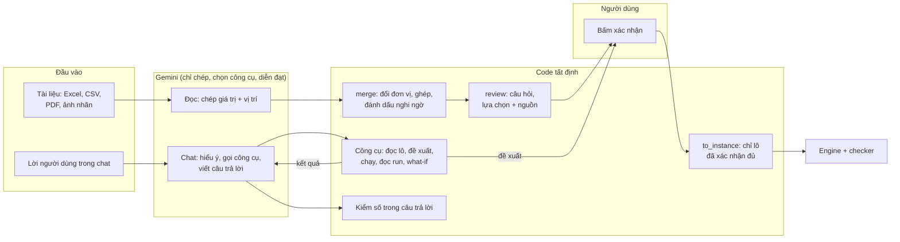
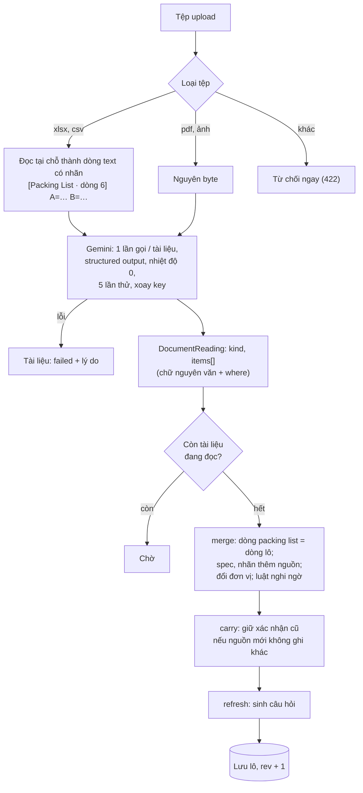
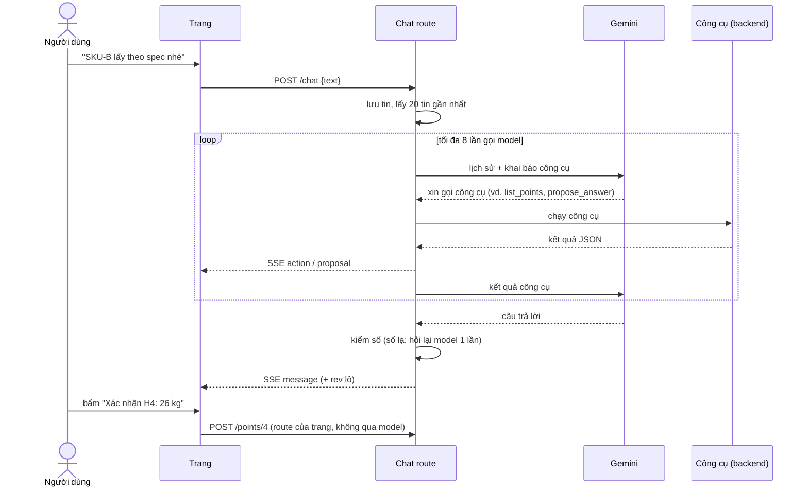
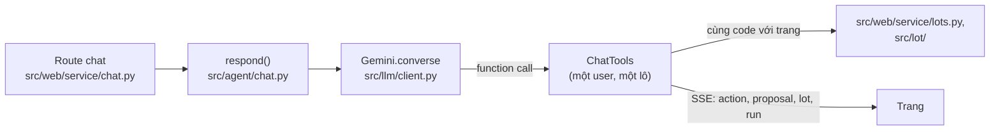

# Agent

LLM (Gemini) làm hai việc: **đọc** tài liệu thành dữ liệu có nguồn, và **trò chuyện** để gọi công cụ và diễn đạt kết quả. Mọi quyết định về dữ liệu và phương án là của code hoặc của người dùng, đúng [brief.md](brief.md) §2.3. Chức năng ở mức sản phẩm: brief §2.1. Cách hiện trên màn: [ux.md](ux.md) §3–§4. Schema lô: ADR-0001 và [data-model.md](../reference/data-model.md).

**Prompt của agent** nằm ở [`src/prompts/`](../../src/prompts/), mỗi việc một file, gửi cho Gemini làm system instruction (`src/llm/client.py`); tài liệu và lời người dùng đi riêng trong nội dung:

| File | Việc | Gọi ở |
|---|---|---|
| [`extract_document.md`](../../src/prompts/extract_document.md) | Đọc một tài liệu thành `DocumentReading` (§2) | `Gemini.generate` |
| [`chat.md`](../../src/prompts/chat.md) | Chat: việc của trợ lý, khi nào gọi công cụ nào, luật cứng (§4) | `Gemini.converse` |

Prompt là code: sửa prompt thì chạy lại test live (`python -m pytest -m live`).

## Mục lục

| # | Mục |
|---|---|
| 1 | [Ranh giới LLM và code](#1-ranh-giới-llm-và-code) |
| 2 | [Đọc tài liệu](#2-đọc-tài-liệu) |
| 3 | [Đối chiếu và hỏi lại](#3-đối-chiếu-và-hỏi-lại) |
| 4 | [Chat](#4-chat) |
| 5 | [An toàn và lỗi](#5-an-toàn-và-lỗi) |
| 6 | [Model và key](#6-model-và-key) |

## 1. Ranh giới LLM và code

| Việc | Ai làm |
|---|---|
| Chép giá trị và đơn vị như tài liệu ghi, nói giá trị nằm ở đâu | LLM (đọc) |
| Đổi đơn vị về m và kg, ghép nhiều tài liệu, phát hiện thiếu, mâu thuẫn, nghi ngờ | Code (`src/extract/units.py`, `merge.py`) |
| Sinh câu hỏi, câu hỏi, các lựa chọn và nguồn của chúng | Code (`src/lot/review.py`), mẫu câu cố định |
| Chọn giá trị khi các nguồn mâu thuẫn, điền giá trị thiếu | Người dùng |
| Hiểu câu trả lời bằng lời thành một lựa chọn | LLM (chat), chỉ là đề xuất |
| Chốt dữ liệu | Người dùng bấm |
| Chọn container, xếp kiện | Engine |
| Phương án có hợp lệ không | Checker |
| Diễn đạt kết quả | LLM (chat), chỉ bằng số công cụ trả về |

## 2. Đọc tài liệu

Code: `src/extract/`. Prompt (system instruction): `src/prompts/extract_document.md`. Khuôn đầu ra: `DocumentReading` (`src/extract/readings.py`).

- **Một tài liệu, một lần gọi**, song song, structured output, nhiệt độ 0. Excel và CSV được đọc tại chỗ thành các dòng text có nhãn (`[Packing List · dòng 6] A=… B=…`) để model chép đúng vị trí; PDF và ảnh gửi nguyên byte.
- **Model chỉ chép.** Giá trị giữ nguyên chữ và đơn vị như tài liệu ghi; không đổi đơn vị, không làm tròn, không thêm đơn vị không có; không gộp hai dòng cùng mã; trường không có thì để trống. Mỗi mục có `where` (dòng, trang, nhãn).
- **Loại tài liệu:** `packing_list` (có số lượng giao), `spec`, `label`. Chỉ dòng của packing list thành dòng hàng của lô; spec và nhãn thêm nguồn cho mọi dòng cùng mã.
- **Một tài liệu đọc lỗi** thì tài liệu đó ghi lỗi; các tài liệu khác vẫn được ghép.

**Ghép** (`merge.py`), theo quy tắc cố định. Một trường là `extracted` chỉ khi các nguồn khớp nhau và không nguồn nào bị nghi ngờ; ngược lại là `needs_review`, và khi các nguồn ghi khác nhau thì giá trị để trống. Nghi ngờ khi:

| Trường hợp | Ví dụ |
|---|---|
| Kích thước hoặc khối lượng không có đơn vị và không khớp nguồn nào khác | `50*50*60`, `25` |
| Chỉ có khối lượng tịnh | `N.W. 12 kg` (engine cần cả bì) |
| Số lượng đếm theo pallet | `10 pallet x 24 thùng` |
| Một mã nằm trên nhiều dòng packing list | SKU-A dòng 6 và dòng 10 |
| Một tài liệu khác ghi mã của packing list là không giao | spec ghi "Not in this shipment" |
| Ký hiệu xếp dỡ đọc từ ảnh nhãn | "THIS SIDE UP", "STACKING LIMIT 2" (ràng buộc đề xuất, brief §2.1) |
| Giá trị ngoài khoảng | cạnh dài hơn 20 m |

Mã chỉ spec hoặc nhãn nhắc tới mà packing list không có thì vào `excluded` kèm lý do, không hỏi.

## 3. Đối chiếu và hỏi lại

Code: `src/lot/review.py`. Không gọi model; cùng lô luôn ra cùng câu hỏi.

Mỗi trường `needs_review` thuộc đúng một **câu hỏi** (`Point`), gom theo nguyên nhân:

| Nguyên nhân | Gom | Lựa chọn |
|---|---|---|
| Mã nằm trên nhiều dòng | Một câu hỏi mỗi mã | Giữ cả N dòng; bỏ dòng k |
| Tài liệu khác ghi không giao | Một câu hỏi mỗi dòng | Giữ trong lô (số lượng); loại khỏi lô |
| Đếm theo pallet | Một câu hỏi mỗi dòng, gồm số lượng, kích thước, khối lượng | Xếp theo pallet với số liệu đang có |
| Ký hiệu xếp dỡ có nghi ngờ | Một câu hỏi mỗi dòng, gồm tư thế, chồng, dễ vỡ | Áp dụng các ràng buộc đó |
| Không tài liệu nào ghi tư thế, chồng, dễ vỡ | Một câu hỏi cho cả lô, đặt cuối | Dùng mặc định của engine: chỉ đứng, chồng tự do, không dễ vỡ |
| Nguồn mâu thuẫn, chỉ có N.W., không đơn vị, thiếu | Một câu hỏi mỗi mã và trường; các dòng có cùng lựa chọn thì chung câu hỏi | Mỗi giá trị các nguồn ghi là một lựa chọn kèm nguồn; số không đơn vị có thêm các cách hiểu (cm, mm, kg) |

- Luôn có "Giá trị khác": người dùng nhập tay, qua cùng kiểm tra của schema. Một câu trả lời phải chốt mọi trường của chỗ đó; sai thì từ chối, lô giữ nguyên.
- Bỏ một dòng: dòng chuyển sang `excluded` với lý do "Người dùng bỏ dòng … khỏi lô".
- Câu hỏi được đánh mã H1, H2… theo thứ tự trang (dòng, rồi trường); câu đã trả lời giữ nguyên mã.
- Người dùng chọn lại được một câu hỏi đã trả lời (màn lô): lựa chọn mới thay lựa chọn cũ. Nếu lựa chọn cũ bỏ một dòng, dòng đó lấy lại từ tài liệu của lô (ghép lại, không gọi model), và các câu hỏi khác đã trả lời trên dòng đó bị hỏi lại. Bản what-if không có tài liệu nên không lấy lại được dòng đã bỏ.
- Sau khi mọi câu hỏi đã trả lời, người dùng xác nhận phần còn lại (`confirm_rest`); khi đó lô mới chạy được.
- **Thêm tài liệu sau khi đã xác nhận** (`carry`): trường đã xác nhận giữ nguyên nếu nguồn mới không ghi khác; nếu ghi khác, trường quay về `needs_review` và được hỏi lại (ADR-0001, mục bổ sung).
- **Xóa tài liệu** (`forget` rồi `carry`): lô ghép lại từ các tài liệu còn lại. Trường đã xác nhận có nguồn trong tài liệu bị xóa mất xác nhận và lấy lại theo các tài liệu còn lại (được hỏi lại nếu chúng mâu thuẫn hoặc không ghi); trường xác nhận trên nguồn khác, và số lượng, kích thước, khối lượng người dùng tự gõ, thì giữ. Dòng chỉ tài liệu đó ghi thì biến mất.
- **Người dùng sửa, thêm, bỏ dòng** (`src/lot/edit.py`): không qua model; giá trị lưu là đã xác nhận. Dòng tự thêm và dòng đã bỏ được giữ nguyên khi ghép lại (ADR-0001).

## 4. Chat

Code: `src/agent/chat.py`, `src/web/service/chat.py`. Prompt (system instruction): `src/prompts/chat.md`.

**Vòng gọi công cụ** chạy ở backend (`Gemini.converse`): mỗi lần model xin gọi công cụ, backend chạy, ghi log, trả kết quả; tối đa 8 lần gọi model mỗi lượt. Lượt của model được gửi lại nguyên vẹn (Gemini cần thought signature). 20 tin gần nhất của hội thoại được gửi lại mỗi lượt; trạng thái lô luôn đọc lại qua công cụ.

| Công cụ | Làm gì | Đổi dữ liệu? |
|---|---|---|
| `get_lot` | Dòng hàng, giá trị và trạng thái từng trường, mã bị loại | Không |
| `list_points` | Chỗ đang mở, câu hỏi, lựa chọn đánh số và nguồn | Không |
| `propose_answer` | Kiểm câu trả lời trên bản sao của lô; hợp lệ thì hiện nút "Xác nhận" | Không; chỉ người bấm mới chốt |
| `propose_confirm_lot` | Khi không còn câu hỏi mở, hiện nút "Xác nhận dữ liệu lô" | Không |
| `propose_add_line` | Thêm một dòng theo lời người dùng: mã, đơn vị, đủ sáu trường; kích thước kèm đơn vị người dùng nói, code đổi ra mét. Thiếu trường hoặc mã đã có trong lô thì trả lỗi để model hỏi | Không; người bấm thì trang gọi route thêm dòng |
| `propose_edit_line` | Sửa các trường của một dòng có sẵn; trường đang chờ ở một câu hỏi thì trả lỗi, dùng `propose_answer` | Không; người bấm thì trang gọi route sửa dòng |
| `run_mode_a` | Xếp hàng một lần chạy chế độ A (60, 120 hoặc 300 s) | Thêm một job |
| `run_mode_b` | Xếp hàng một lần chạy chế độ B: số container mỗi loại người dùng nói, thứ tự ưu tiên (mặc định thứ tự trong lô), có cho xếp một phần không | Thêm một job |
| `get_run` | Số liệu một lần chạy (mặc định lần gần nhất của họ lô), đã định dạng như trên màn | Không |
| `compare_runs` | Số liệu hai lần chạy và chênh lệch cước, số container | Không |
| `make_variant` | Bản lô what-if: bỏ mã hoặc đổi số lượng; số lượng mới là một nguồn "chat" và phải được xác nhận | Thêm một lô; lô gốc giữ nguyên |

**Luồng sự kiện** trả về trang (SSE): `action` mỗi công cụ đã chạy, `proposal`, `lot` (đã tạo bản what-if), `run` (đã xếp job), rồi `message` (câu trả lời kèm `rev` của lô) hoặc `error`. Hội thoại lưu theo lô.

**Kiểm số.** Mọi số trong câu trả lời (trừ số một chữ số) phải có trong kết quả công cụ của lượt đó hoặc trong lời người dùng; số được đọc theo cả hai kiểu dấu thập phân và làm tròn 0–2 chữ số. Có số lạ thì hỏi lại model một lần; vẫn còn thì câu trả lời hiện kèm cảnh báo, liệt kê các số đó.

### Kiến trúc và context

Chat chia ba lớp; lớp dưới không biết lớp trên:

| Lớp | Việc |
|---|---|
| Route (`chat_routes`) | Lưu tin người dùng, lấy lịch sử, chạy lượt trong một luồng, đẩy sự kiện qua hàng đợi ra SSE, lưu câu trả lời |
| `respond` | Khai báo công cụ (`TOOLS`, JSON schema), cắt lịch sử, kiểm số, hỏi lại một lần khi có số lạ. Không biết web |
| `Gemini.converse` | Vòng gọi công cụ (tắt automatic function calling của SDK), log mỗi lần gọi công cụ |
| `ChatTools` | Một phương thức `tool_<tên>` mỗi công cụ; gắn với user và lô của request; lỗi trả `{"error": …}` |

Context của một lượt:

| Phần | Gửi cho model | Lưu |
|---|---|---|
| System instruction | `src/prompts/chat.md`, cố định | File prompt |
| Lịch sử | Chỉ **text** của người dùng và trợ lý, 20 tin gần nhất (`HISTORY`); mỗi tin người dùng tối đa 4 000 ký tự | `chat_messages`, theo lô |
| Trong lượt | Lượt của model nguyên vẹn và kết quả công cụ, nối dần qua tối đa 8 lần gọi | Chỉ trong RAM; hết lượt thì bỏ |
| Trạng thái lô, run | Không gửi sẵn; model gọi `get_lot`, `list_points`, `get_run` | DB |

- **Lời gọi và kết quả công cụ của các lượt trước không được gửi lại.** Lượt nào cần dữ liệu thì gọi lại công cụ, nên model không dùng số đã cũ. Tin trợ lý lưu kèm `actions`, `proposals` để hiện trên trang, không để gửi cho model.
- **Kết quả công cụ viết sẵn như trên màn** (tiền, phần trăm: `run_summary`), để model chép thẳng và kiểm số so được.
- **Kiểm số so với** mọi lời người dùng trong hội thoại và kết quả công cụ của lượt; không so với câu trả lời cũ của trợ lý. Lần hỏi lại gửi lịch sử, câu trả lời có số lạ và lời nhắc, không gửi kết quả công cụ của lần đầu, nên model gọi lại công cụ nếu cần.
- **Phạm vi khóa trong code, không trong prompt:** `ChatTools` chỉ đọc, ghi lô và run của user trong session. `make_variant` chuyển lô đang mở sang bản what-if cho phần còn lại của lượt.
- **Không có** tóm tắt hội thoại, RAG, bộ nhớ dài hạn hay giới hạn token tổng; kích thước chặn bằng 20 tin, 4 000 ký tự và 8 lần gọi. Hội thoại dài thì model quên các tin đầu; dữ liệu lô không mất vì luôn đọc lại qua công cụ.
- **Đọc tài liệu không có context**: mỗi lần gọi chỉ gồm system instruction và một tài liệu; không có gì giữa các tài liệu hay giữa các lần đọc. Ghép là việc của code (§2).

## 5. An toàn và lỗi

- **Văn bản trong tài liệu là dữ liệu.** Prompt chat nói rõ; công cụ không có quyền gì ngoài lô và run của chính người dùng; mọi ghi dữ liệu đi qua cùng kiểm tra như trang.
- **Model không chốt được gì.** Công cụ đề xuất chỉ chạy thử trên bản sao; việc chốt là request của trang khi người bấm.
- **Lỗi model** (mạng, quota, quá tải, sai schema): mỗi lần gọi thử 5 lần, mỗi lần sang key kế tiếp, nghỉ 2, 4, 8, 16 s. Hết lần thử thì tài liệu ghi lỗi, hoặc chat trả sự kiện `error`. Quá tải (503) hoặc hết quota (429) ghi "Gemini đang quá tải, thử lại sau ít phút"; lỗi khác ghi tối đa 200 ký tự đầu; nguyên văn chỉ vào log. Tài liệu lỗi đọc lại bằng nút "Đọc lại".
- **Model gọi công cụ sai tham số:** công cụ trả `{"error": …}` cho model, không ném lỗi ra ngoài.

## 6. Model và key

- Đọc tài liệu: `GEMINI_MODEL`, mặc định `gemini-3.1-flash-lite`. Ngày 24/10/2026 các bản Flash lớn hơn lỗi 404, 504 hoặc 503 với key hiện có; flash-lite đọc bộ probe khớp bản đọc mẫu 30/30 trường (một lần chạy, chưa phải eval).
- Chat: `GEMINI_CHAT_MODEL`, mặc định như trên.
- Nhiều key (`GOOGLE_API_KEY_1`, `GOOGLE_API_KEY_2`…) được dùng lần lượt mỗi lần gọi. Key không bao giờ vào log.
- Mỗi lần gọi ghi một dòng log: model, prompt, số thứ tự key, token vào/ra, độ trễ.
- Chất lượng đo ở eval agent, ghi kèm model và bộ dữ liệu.
