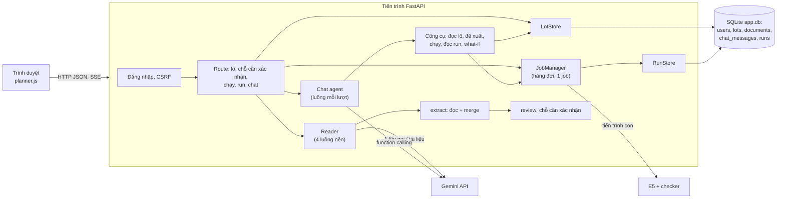
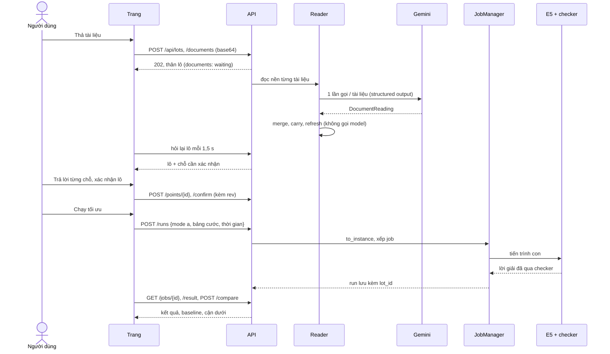

# Kiến trúc

Một deployable: một tiến trình FastAPI phục vụ trang, API, agent và hàng đợi engine; engine chạy trong tiến trình con. Sản phẩm là gì: [brief.md](brief.md). Agent: [agent.md](agent.md). Engine: [engine/](engine/README.md). Dữ liệu: [../reference/data-model.md](../reference/data-model.md). API: [../reference/api.md](../reference/api.md).

Phần web, đăng nhập, hàng đợi job, lưu run, checker, engine và viewer 3D là nền có sẵn từ một dự án trước của tác giả; agent, chế độ B và giao diện lô là phần mới.

## Mục lục

| # | Mục |
|---|---|
| 1 | [Thành phần](#1-thành-phần) |
| 2 | [Luồng một lô](#2-luồng-một-lô) |
| 3 | [Lưu trữ](#3-lưu-trữ) |
| 4 | [Đồng thời và giới hạn](#4-đồng-thời-và-giới-hạn) |
| 5 | [Cấu hình](#5-cấu-hình) |
| 6 | [Bảo mật](#6-bảo-mật) |

## 1. Thành phần

| Thành phần | Code | Việc |
|---|---|---|
| App | `src/web/service/app.py` | Dựng FastAPI: đăng nhập, route, trang `/`, file tĩnh `/static/shared` |
| Đăng nhập | `src/web/auth.py`, `src/web/users.py` | Phiên cookie, tài khoản do admin tạo bằng CLI |
| Lô | `src/web/lotstore.py`, `src/web/service/lots.py` | Lưu lô, tài liệu, hội thoại; route lô, chỗ cần xác nhận, chạy, so baseline |
| Đọc tài liệu | `src/extract/`, `Reader` trong `src/web/service/lots.py` | Đọc từng tài liệu bằng Gemini trong luồng nền, ghép lô bằng quy tắc cố định |
| Đối chiếu | `src/lot/review.py` | Sinh chỗ cần xác nhận, áp câu trả lời, giữ xác nhận khi thêm tài liệu |
| Lô → engine | `src/lot/engine.py` | `to_instance`: cổng duy nhất sang engine, từ chối lô còn trường chưa xác nhận |
| Chat | `src/agent/chat.py`, `src/web/service/chat.py` | Gemini function calling, công cụ chạy ở backend, luồng sự kiện SSE |
| Model | `src/llm/client.py` | Chỗ duy nhất gọi SDK `google-genai`: retry, xoay key, log |
| Chế độ A | `src/plan/mode_a.py` | Bảng cước mặc định, chọn engine, baseline, cận dưới |
| Chế độ B | `src/plan/mode_b.py`, `src/engines/fill.py` | Container có sẵn, thứ tự ưu tiên, baseline lấp lần lượt; chấm trên lô các kiện đã xếp ([ADR-0002](../adr/0002-che-do-b.md)) |
| Hàng đợi | `src/web/job_manager.py`, `src/jobs.py` | Một job một lúc, engine trong tiến trình con, timeout, giới hạn bộ nhớ |
| Engine | `src/engines/` | E5 (`e5`, `e5-orient`), `e5-fill` của chế độ B và các lõi chúng dùng |
| Checker | `src/checker.py` | Trọng tài độc lập; không import code giải ([constraints.md](../reference/constraints.md)) |
| Lưu run | `src/web/runstore.py` | Mỗi run xong là một dòng SQLite |
| Giao diện | `src/web/static/shared/planner.js`, `src/web/service/static/` | SPA theo hash ([ux.md](ux.md)); màn một container 3D là màn của viewer, dựng trong cùng trang |

## 2. Luồng một lô

1. **Tạo lô và upload.** Trang gửi tài liệu dạng JSON base64. Backend kiểm cỡ và loại tệp, lưu blob, trả lô ngay; mỗi tài liệu vào hàng đọc nền.
2. **Đọc.** Mỗi tài liệu là một lần gọi Gemini với structured output. Excel, CSV đọc thành text tại chỗ; PDF và ảnh gửi nguyên byte. Kết quả đọc (`DocumentReading`) lưu cạnh tài liệu.
3. **Ghép và đối chiếu.** Khi không còn tài liệu nào chờ đọc, mọi bản đọc được ghép lại bằng `merge`, rồi `carry` giữ những gì người dùng đã xác nhận, rồi `refresh` sinh chỗ cần xác nhận. Không gọi model ở bước này.
4. **Xác nhận.** Người dùng trả lời từng chỗ (trang hoặc nút trong chat), rồi xác nhận phần còn lại. Mỗi lần ghi mang `rev`; `rev` cũ thì 409.
5. **Chạy.** `to_instance` đổi lô đã xác nhận sang lô của engine; job vào hàng đợi; engine chạy trong tiến trình con; checker chấm; run lưu kèm `lot_id`, `mode`.
6. **Xem và so.** Màn Kết quả đọc run, gọi baseline và cận dưới; bấm thẻ container mở màn 3D của container đó.

Chat đi song song mọi bước: mọi việc chat làm đều qua cùng code với trang ([agent.md](agent.md) §4).

## 3. Lưu trữ

Một file SQLite (`PLANNER_DB`), schema qua migration trong `src/web/db.py`. Bảng: [data-model.md](../reference/data-model.md) §4.

- Tài liệu upload là blob trong cùng file DB, mỗi tệp tối đa 10 MB.
- Run giữ bản chụp lô engine, thiết lập và lời giải của riêng nó; xóa lô không xóa run (`lot_id` thành `NULL`).
- Run cũ hơn `PLANNER_RUN_DAYS` ngày (mặc định 30) bị xóa khi app khởi động và sau mỗi lần ghi run. Lô bị xóa giữ 1 ngày để hoàn tác.
- Không có object storage. File DB nằm trên đĩa dữ liệu riêng của VM.

## 4. Đồng thời và giới hạn

| Việc | Cách chạy | Giới hạn |
|---|---|---|
| Engine | Một job một lúc (tránh hai job tranh CPU làm lệch cước); job khác xếp hàng | Hàng đợi 5; thời gian 10–600 s; job quá 1,5 × giới hạn bị giết; bộ nhớ theo `PLANNER_JOB_MEM_MB` |
| Đọc tài liệu | Luồng nền, 4 luồng | Mỗi lần gọi model timeout 120 s, 5 lần thử (nghỉ 2, 4, 8, 16 s), mỗi lần thử sang key kế tiếp |
| Chat | Một luồng mỗi lượt, gửi sự kiện qua SSE | Tối đa 8 lần gọi model mỗi lượt; 20 tin gần nhất gửi lại cho model |
| Ghi lô | Khóa lạc quan bằng `rev` | Ghi trên `rev` cũ trả 409 `conflict` |

## 5. Cấu hình

Biến môi trường, đọc một lần khi app khởi động (`.env` được nạp khi chạy `python -m src.web`; biến đã đặt sẵn thắng):

| Biến | Dùng cho | Mặc định |
|---|---|---|
| `PLANNER_DB` | File SQLite | `/data/app.db` |
| `PLANNER_ORIGINS` | Origin được phép gửi request đổi trạng thái, cách nhau bởi dấu phẩy | rỗng: mọi request ghi bị 403 |
| `PLANNER_RUN_DAYS` | Số ngày giữ run | 30 |
| `PLANNER_JOB_MEM_MB` | Ngưỡng bộ nhớ của một job | theo RAM máy |
| `PLANNER_ADMIN_NAME`, `PLANNER_ADMIN_PASSWORD` | Tạo admin bằng `python -m src.web.users seed` | — |
| `GOOGLE_API_KEY`, `GOOGLE_API_KEY_1`, `GOOGLE_API_KEY_2`… | Key Gemini, dùng lần lượt | bắt buộc khi đọc tài liệu hoặc chat |
| `GEMINI_MODEL` | Model đọc tài liệu | `gemini-3.1-flash-lite` |
| `GEMINI_CHAT_MODEL` | Model chat | như `GEMINI_MODEL` |
| `GEMINI_THINKING` | Mức thinking | mặc định của model |

## 6. Bảo mật

- Mọi route trừ `/login`, `/healthz` và `style.css` cần phiên đăng nhập. Phiên sống 12 giờ, không gia hạn trượt. Sai mật khẩu 5 lần trong 15 phút thì khóa tên đó 15 phút.
- Request đổi trạng thái phải có `Origin` trong `PLANNER_ORIGINS` và body JSON (chống CSRF). Cookie có cờ `Secure`: chạy ở máy thì mở bằng `http://localhost`.
- Mọi truy vấn lô, tài liệu, hội thoại, run lọc theo người dùng; của người khác trả 404 như không tồn tại.
- Key Gemini không bao giờ được log hay gửi xuống trình duyệt. Văn bản trong tài liệu chỉ đi vào model như dữ liệu ([agent.md](agent.md) §5).
