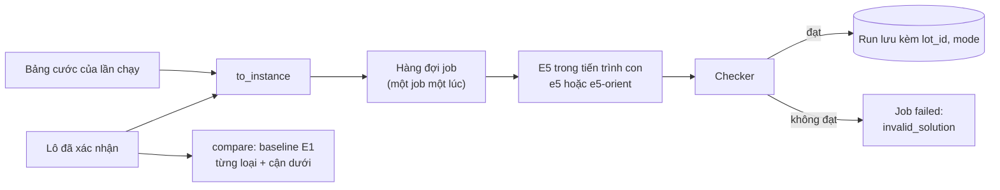
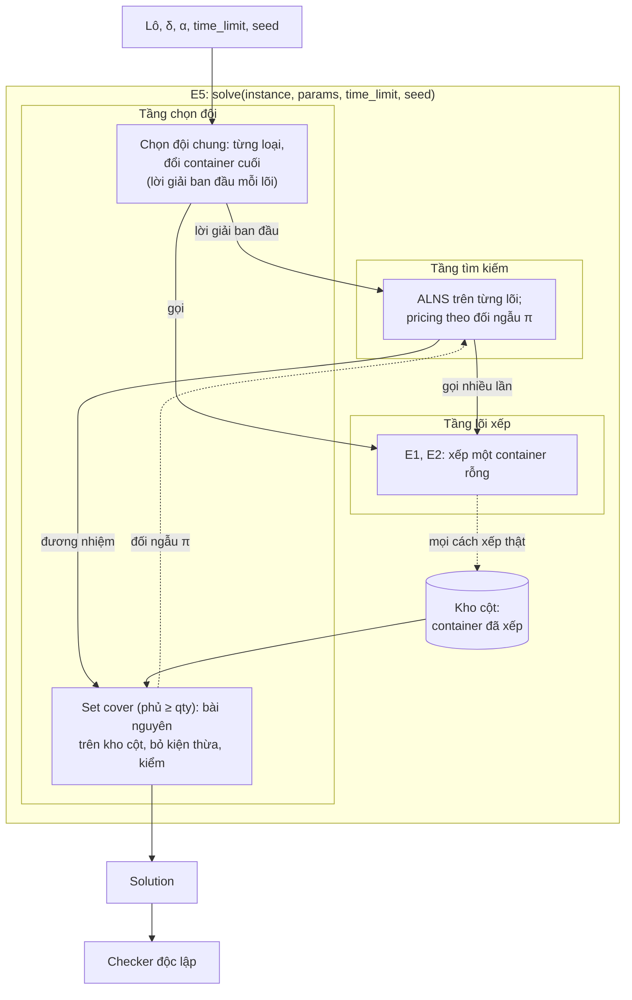

# Engine tối ưu

Engine lập phương án xếp từ một lô đã xác nhận đủ. Hai chế độ ở mức sản phẩm: [brief.md](../brief.md) §2.2. Ràng buộc mọi phương án phải thỏa: [constraints.md](../../reference/constraints.md). Engine, checker và cận dưới có từ một dự án trước của tác giả; các file đặc tả thuật toán trong thư mục này đi cùng code đó ([e5](e5.md), [core-e1](core-e1.md), [core-e2](core-e2.md), [alns](alns.md)) hoặc viết từ code ([fleet](fleet.md), [bound](bound.md)). Code thắng khi lệch.

## Mục lục

| # | Mục |
|---|---|
| 1 | [Từ lô sang engine](#1-từ-lô-sang-engine) |
| 2 | [Chế độ A: tối thiểu tổng cước](#2-chế-độ-a-tối-thiểu-tổng-cước) |
| 3 | [So sánh: baseline và cận dưới](#3-so-sánh-baseline-và-cận-dưới) |
| 4 | [Chế độ B](#4-chế-độ-b) |
| 5 | [Số đo đã có](#5-số-đo-đã-có) |
| 6 | [Kiến trúc E5: ba tầng](#6-kiến-trúc-e5-ba-tầng) |
| 7 | [Tập con nghiệm mỗi lõi tìm](#7-tập-con-nghiệm-mỗi-lõi-tìm) |
| 8 | [Thứ tự đọc và code ở đâu](#8-thứ-tự-đọc-và-code-ở-đâu) |

## 1. Từ lô sang engine

`src.lot.engine.to_instance` là cổng duy nhất (ADR-0001): từ chối lô còn bất kỳ trường nào chưa `confirmed`; đổi mỗi dòng thành một loại kiện của engine:

| Lô | Engine |
|---|---|
| `qty`, `dims` (m), `mass` (kg, một kiện, cả bì) | `qty`, `L`, `W`, `H`, `mass` |
| `posture`: `upright` / `tippable` | `tippable`: `false` (chỉ xoay quanh trục đứng) / `true` (cả sáu tư thế) |
| `stacking`: `free` / `limited n` / `none` | không giới hạn tầng / `tiers = n` / `tiers = 1`, `load = 0` |
| `fragile` | không dùng: chỉ để hiện; ràng buộc thật nằm ở tư thế và chồng |

Loại container và cước không thuộc lô: chúng là thiết lập của từng lần chạy. Tham số mô hình cố định trong bản này: `δ = 0,05 m`, `α = 0,8` ([constraints.md](../../reference/constraints.md) §2).

## 2. Chế độ A: tối thiểu tổng cước

Code: `src/plan/mode_a.py`; route `POST /api/lots/{id}/runs` ([api.md](../../reference/api.md)).

- **Mục tiêu:** xếp hết mọi kiện, tổng cước các container dùng nhỏ nhất. Bộ giải chọn loại và số container; không LLM nào liệt kê hay đoán tổ hợp.
- **Engine:** E5 ([§6](#6-kiến-trúc-e5-ba-tầng), [e5.md](e5.md)). `e5-orient` (cho lật kiện chủ động, [e5 §4](e5.md#4-tùy-chọn-e5-orient)) dùng khi lô có dòng `tippable`; lô toàn hàng đứng dùng `e5`, vì lật không áp dụng được. Người dùng không bật cờ lật: cờ suy ra từ lô.
- **Bảng cước:** người dùng bật hoặc tắt từng loại, sửa cước trên màn Chạy; bảng được lưu cùng lô cho các lần sau. Bảng mặc định:

| Loại | Lòng (m) | Cửa (m) | Tải (kg) | Cước (USD) |
|---|---|---|---|---|
| 20GP | 5,898 × 2,352 × 2,393 | 2,34 × 2,28 | 28 000 | 1 500 |
| 40GP | 12,032 × 2,352 × 2,393 | 2,34 × 2,28 | 26 700 | 2 300 |
| 40HC | 12,032 × 2,352 × 2,698 | 2,34 × 2,58 | 26 500 | 2 500 |

Cước trong bảng là **số giả lập**, không phải báo giá. Kích thước và tải theo chuẩn công khai của container khô.

- **Thời gian:** 1, 2 hoặc 5 phút (service nhận 10–600 s); seed cố định 1. E5 có thể dừng sớm khi không còn cải thiện ([e5 §2](e5.md#2-luồng-chạy-và-chia-thời-gian)). Job chạy quá 1,5 lần giới hạn bị giết.
- **Kiểm tra:** E5 tự chấm mọi lời giải bằng checker và bỏ lời giải không đạt; job chấm lại lần nữa trước khi lưu. Không bao giờ nới luật của checker để một phương án qua.

## 3. So sánh: baseline và cận dưới

`POST /api/lots/{id}/compare` (lô hiện tại) và `POST /api/runs/{job_id}/compare` (lô và tham số lưu kèm một lần chạy; màn Kết quả dùng route này) trả về hai mốc để đặt cước của chế độ A vào bối cảnh:

- **Baseline "lấp lần lượt một loại":** với mỗi loại container mà mọi dòng đều vừa, chạy E1 qua tầng chọn đội chung ([fleet.md](fleet.md)) chỉ với loại đó, 5 s, seed 1; checker chấm từng kết quả. Báo hai baseline trong số kết quả đạt: **một loại rẻ nhất** và **ít container nhất** (hòa thì rẻ hơn). Màn Kết quả so với baseline rẻ nhất.
- **Cận dưới** ([bound.md](bound.md)): cước nhỏ nhất của một đội xe chứa nổi lô theo thể tích, tải và sàn của kiện bắt buộc nằm sàn. Không phương án nào rẻ hơn; thường không đạt được vì bỏ qua hình học.

## 4. Chế độ B

Code: `src/engines/fill.py` (engine `e5-fill`, `e5-fill-orient`), `src/plan/mode_b.py`; route `POST /api/lots/{id}/runs` với `mode: "b"`. Cách đặt bài toán và lý do: [ADR-0002](../../adr/0002-che-do-b.md).

- **Đầu vào:** số container có sẵn mỗi loại; thứ tự ưu tiên các dòng (mặc định: thứ tự trong lô); có cho xếp một phần một dòng không (mặc định có). Cước không dùng.
- **Mục tiêu:** theo thứ tự từ điển: nhiều kiện nhất của dòng ưu tiên 1, giữ số đó rồi nhiều nhất dòng 2, và tiếp tục. Tắt "xếp một phần" thì mỗi dòng lên đủ hoặc không lên kiện nào.
- **Engine:** lõi E1, E2 xếp từng container thành cột; bài nguyên SCIP chọn cột trong giới hạn số container, `Σ a_ip x_p ≤ qty_i`, không có kiện thừa. Chọn biến thể lật như chế độ A.
- **Baseline:** đưa kiện theo thứ tự ưu tiên, lấp lần lượt từng container bằng lõi E1 (`POST /api/runs/{job_id}/compare` của lần chạy, hoặc `POST /api/lots/{id}/compare` với `mode: "b"`); checker chấm. Cột baseline luôn trong kho, nên kết quả không kém baseline.
- **Kiểm tra:** phương án chấm trên lô con gồm các kiện đã xếp, bằng checker giữ nguyên; job kiểm thêm số container không vượt số có sẵn.
- **Số đo** (lô probe, giả lập; 10–20 s, seed 1, δ 0,05, α 0,8; ngày 25/10/2026): mọi bộ container đã thử (1 × 40HC; 1 × 40GP; 2 × 20GP; 1 × 20GP + 1 × 40GP; 1 × 20GP + 1 × 40HC), cả hai trạng thái "xếp một phần", đều **bằng** baseline; chưa thấy lần nào hơn. Ví dụ 1 × 20GP + 1 × 40HC, ưu tiên B, A, C, D, A-2: 365 / 380 kiện, còn 4 pallet SKU-D và 11 thùng SKU-A-2. Đo đầy đủ để sau.

## 5. Số đo đã có

Lô probe (`data/probe`, giả lập; 380 kiện, 73,0 m³, 7 580 kg), bảng cước mặc định, `δ = 0,05`, `α = 0,8`, đo ngày 24/10/2026:

| Thiết lập | Kết quả |
|---|---|
| E5, 10 s, seed 1–3 | 2 × 40GP = 4 600 USD, checker đạt |
| E5, 300 s, seed 1–3 | Cả 3 seed: 2 × 40GP = 4 600 USD, dừng sớm (235–261 s) |
| E5, 120 s, seed 1, chỉ 20GP + 40GP | 2 × 40GP = 4 600 USD |
| E5, 120 s, seed 1, chỉ 20GP + 40HC | 2 × 40HC = 5 000 USD |
| Baseline một loại | 20GP: 4 × = 6 000; 40GP: 2 × = 4 600; 40HC: 2 × = 5 000 USD |
| Cận dưới | 2 500 USD (1 × 40HC, theo thể tích) |

Trên lô này E5 chỉ bằng baseline tốt nhất. Chưa chứng minh tổ hợp 1 × 40HC + 1 × 20GP (4 000 USD) xếp được; khoảng cách tới cận dưới chưa giải thích được. Eval engine có hệ thống để sau.

## 6. Kiến trúc E5: ba tầng

E5 ghép ba tầng: **lõi xếp** một container, **tìm kiếm**, **chọn đội** container theo cước. Tìm kiếm không nhằm ra lời giải cuối mà để **sinh cột**: mỗi container lõi đã xếp thật là một cột trong kho, và chọn đội là bài set cover trên kho đó (phủ ≥ `qty`, rồi bỏ kiện thừa). Vì vậy E5 không bao giờ trả lời giải tệ hơn lời giải tốt nhất mà tìm kiếm đã có.

| Tầng | Trong E5 | Đặc tả |
|---|---|---|
| **Lõi xếp** | E1 (chồng trước, trải sàn sau) và E2 (extreme point); mỗi lần gọi xếp một container rỗng một loại, tất định. `e5-orient` thêm lõi `e1-orient-dense` và chế độ `orient` của E2 | [core-e1.md](core-e1.md), [core-e2.md](core-e2.md) |
| **Tìm kiếm** | ALNS trên từng lõi, bắt đầu từ lời giải ban đầu của lõi đó; rồi pricing: gọi lõi trên kiện xếp theo đối ngẫu LP | [alns.md](alns.md), [e5 §3.3](e5.md#33-pricing) |
| **Chọn đội** | Lời giải ban đầu: tầng chọn đội chung. Lời giải trả về: bài nguyên phủ ≥ `qty` trên kho cột (GLOP cho LP, SCIP cho bài nguyên), bỏ kiện thừa, kiểm bằng checker; lấy rẻ nhất trong đương nhiệm và các lời giải bài nguyên | [fleet.md](fleet.md), [e5 §3](e5.md#3-chọn-đội-bài-chính-pricing-bỏ-kiện-thừa-kiểm) |

`e5` và `e5-orient` là bí danh của phiên bản `e5-v4` (ALNS dừng khi chững). Các phiên bản trước và biến thể đo không được đăng ký (`src/engines/__init__.py`); code của chúng còn trong `src/engines/e5/` vì E5 import chung module.

## 7. Tập con nghiệm mỗi lõi tìm

Engine được tìm trong một tập con của nghiệm hợp lệ, miễn mọi lời giải trả về qua checker đầy đủ và tài liệu ghi rõ tập con. Mọi lời giải E5 là một đội container, **mỗi container do một lõi xếp**; E5 không ghép layout hai lõi trong một container, và bỏ kiện thừa chỉ lấy bớt kiện hoặc xếp lại bằng chính lõi.

| Lõi | Tìm | Không bao giờ sinh |
|---|---|---|
| **E1** | Kiện chồng thành cột cùng góc `(x, y)`, cột đặt lên sàn, đỡ 100% | Kiện **vắt** (tựa lên ≥ 2 kiện đỡ), kiện **nhô** (đỡ < 100%); kiện lơ lửng; kiện gối chân lên hai cột |
| **E2** | Kiện đặt ở góc mở bất kỳ, kể cả vắt qua nhiều kiện đỡ và nhô, miễn đỡ ≥ `α` và qua kiểm ràng buộc 5, 7, 8 | Mọi thứ ngoài các góc mở sinh bằng phép chiếu Crainic |

Tư thế: mặc định chỉ lật khi bắt buộc; `e5-orient` mở thêm. Cả hai lõi tham lam nên cũng không phủ mọi cách xếp trong tập của mình ([e5 §7](e5.md#7-giới-hạn-đã-biết)). **Hệ quả:** khoảng cách cước tới cận dưới không phải khoảng cách tới tối ưu của tập con; mọi khẳng định "tối ưu" về E5 phải ghi so với tập nào.

## 8. Thứ tự đọc và code ở đâu

Theo tầng, từ dưới lên: [core-e1](core-e1.md), [core-e2](core-e2.md), [fleet](fleet.md), [alns](alns.md), [e5](e5.md) (hợp đồng, luồng chạy theo thời gian, chọn đội, pricing, `e5-orient`, tham số, thông tin chạy, giới hạn đã biết), [bound](bound.md).

| Phần | Code |
|---|---|
| Chế độ A, baseline | `src/plan/mode_a.py` |
| Lô → engine | `src/lot/engine.py` |
| Luồng E5, `Settings`, pricing, chọn kết quả | `src/engines/e5/engine.py` |
| Kho cột, `RecordingPacker` | `src/engines/e5/pool.py` |
| LP (GLOP), bài nguyên (SCIP) | `src/engines/e5/master.py` |
| Bỏ kiện thừa, dựng `Solution` | `src/engines/e5/trim.py` |
| Đăng ký engine | `src/engines/__init__.py`, `src/engines/e5/__init__.py` |
| Lõi E1 | `src/engines/e1/` |
| Lõi E2 | `src/engines/e2/` |
| ALNS, bộ nhớ đệm | `src/engines/e4/` |
| Tầng chọn đội chung | `src/engines/fleet.py` |
| `Hints`, `Piece`, giao diện engine | `src/engines/base.py` |
| Cận dưới | `src/bound.py` |
| Checker | `src/checker.py` |
| Hàng đợi job, tiến trình con | `src/web/job_manager.py`, `src/jobs.py` |
