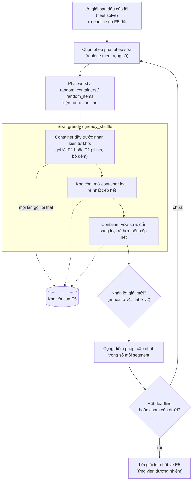

# ALNS trong E5

> Một phần của [đặc tả engine](README.md). Code thắng khi lệch.

> Một phần của [đặc tả engine của service](README.md). Chạy trong bước gom cột của [E5](e5.md#2-luồng-chạy-và-chia-thời-gian), trên lõi [E1](core-e1.md) và [E2](core-e2.md).

Luồng chạy (chi tiết ở các mục dưới):

## 1. Cách chạy

ALNS (Ropke và Pisinger 2006) chạy trên **từng lõi** (`src/engines/e4/`), không phải để lấy lời giải mà để **sinh cột**: mọi lần ALNS gọi lõi thật được ghi vào kho. Lời giải ban đầu của ALNS là lời giải ban đầu của lõi (`fleet.solve`); E5 không gọi `e4.solve`, mà dùng vòng `search.Search` với deadline riêng của E5. Ở `e5-v2` E5 giữ `Search` của từng lõi và cho chạy tiếp khi bài nguyên cuối để thừa thời gian ([e5 §2](e5.md#2-luồng-chạy-và-chia-thời-gian)).

- **Trạng thái:** danh sách container, mỗi cái một loại, một tập kiện và cách xếp lõi trả cho đúng tập đó (cùng gợi ý). Container đổi tập kiện thì gọi lại lõi trên container rỗng, giữ chỉ khi lõi xếp hết kiện nó phải chở.
- **Bộ nhớ đệm** (`packer.py`): kết quả lõi lưu theo khóa (loại container, số kiện mỗi dòng, gợi ý), tối đa 20 000 mục. Lần lấy từ đệm không gọi lõi, đã ghi vào kho lúc gọi thật.
- **Mục tiêu:** từ điển (cước, rồi độ đầy container vơi nhất, nhỏ hơn là tốt hơn). Simulated annealing so số vô hướng `cước + 0,01 × độ đầy`.
- **Phép phá** (chọn bằng roulette theo trọng số thích nghi):
  - `worst`: dỡ trống một container vơi nhất, chọn theo hạng ngẫu nhiên `rank = ⌊n · u^p⌋`, `p` = `worst_determinism`.
  - `random_containers`: dỡ trống 1 hoặc 2 container ngẫu nhiên.
  - `random_items`: từ 2 hoặc 3 container ngẫu nhiên, rút ngẫu nhiên `max(1, round(destroy_share × số kiện))` kiện mỗi container (rút hết thì dỡ trống); container đó xếp lại khi sửa, không giữ tọa độ cũ.
- **Phép sửa** (roulette riêng): `greedy` và `greedy_shuffle`.
  1. Container từ đầy tới vơi (`greedy_shuffle`: độ đầy cộng nhiễu đều ≤ `shuffle_noise`). Mỗi container nhận kiện trong kho (thể tích lớn trước; `greedy_shuffle`: nhân hệ số đều 0,8–1,2) tới khi hết thể tích và tải trống; gọi lõi một lần trên kiện cũ cộng kiện nhận; giữ nếu lõi xếp hết kiện cũ. Không được và `hint_retry` bật thì thử một lần với gợi ý ngẫu nhiên: thứ tự dòng mặc định (diện tích đáy giảm dần, khối lượng giảm dần) cộng nhiễu chuẩn độ lệch 1 hạng, hướng xoay một trong ba kiểu (không xoay, xoay hết, ngẫu nhiên từng dòng); thắng thì container giữ gợi ý đó. Container bị phá mà không nhận gì thì xếp lại một mình, kiện lõi bỏ lại vào kho.
  2. Kho còn thì mở container mới: loại rẻ nhất mà một lần gọi lõi xếp hết kho; không loại nào xếp hết thì loại xếp được nhiều thể tích nhất mỗi đơn vị cước; lặp với phần còn lại.
  3. Mỗi container vừa sửa hoặc mở thử từng loại rẻ hơn (rẻ nhất trước), đổi sang loại đầu tiên mà lõi xếp hết kiện của nó.
- **Chấp nhận** (`acceptance`): lời giải mới không tệ hơn thì nhận; tệ hơn `Δ` thì nhận với xác suất `e^(−Δ ÷ nhiệt độ)`. Nhiệt độ đầu `T0 = start_temperature × f(ban đầu) ÷ ln 2` (lời giải tệ hơn `start_temperature` × mục tiêu ban đầu được nhận với xác suất 0,5).
  - `anneal` (`e5-v1`): nguội theo cấp số nhân tới `end_temperature × T0` theo tỉ lệ thời gian đã dùng.
  - `flat` (`e5-v2`): nhiệt độ cố định `flat_temperature × T0`, E5 đặt 0,2. Không đọc đồng hồ, nên vòng thứ k giống nhau với mọi giới hạn thời gian: lần chạy dài lặp lại các vòng của lần chạy ngắn rồi đi thêm.
- **Trọng số phép:** mỗi `segment` vòng, `w ← (1 − reaction) · w + reaction · (tổng điểm ÷ số lần dùng)` cho phép đã dùng; điểm 33 (tốt nhất mới), 9 (tốt hơn hiện tại, chưa gặp), 13 (được nhận, chưa gặp); sàn trọng số 0,001.
- **Dừng:** hết deadline của lõi đó; hoặc cước tốt nhất bằng cận dưới của lô; hoặc (luật chững, `stall_min` khác `None`) số vòng từ lần tốt lên cuối vượt `max(stall_min, stall_ratio × vòng của lần tốt lên cuối)`, `stop` = `stall`. Luật chững tắt ở E4 đứng riêng; E5 từ `e5-v4` đặt 2 000 và 2,0. Vòng đang chạy dở khi hết giờ thì bỏ cả vòng (kiểm hạn trước mỗi lần gọi lõi, không cắt giữa một lần gọi); luồng số ngẫu nhiên và lượt chọn phép của vòng đó được hoàn lại, nên chạy tiếp sau đó đi đúng các vòng như chạy một mạch.
- **Tham số đã chỉnh theo lõi:** E1 `destroy_share` 0,15; E2 `reaction` 0,3; còn lại mặc định ([§2](#2-tham-số)). Không chỉnh lại cho E5.

## 2. Tham số

`src/engines/e4/operators.py` (`Settings`), mặc định theo lõi ở `src/engines/e4/engine.py` (`DEFAULTS`):

| Tên trong code | Lõi E1 | Lõi E2 | Ý nghĩa |
|---|---|---|---|
| `start_temperature` | 0,02 | 0,02 | Lời giải tệ hơn ngần này × mục tiêu ban đầu được nhận với xác suất 0,5 |
| `end_temperature` | 0,01 | 0,01 | Nhiệt độ cuối, theo tỉ lệ nhiệt độ đầu (`anneal`) |
| `acceptance` | `anneal` | `anneal` | Luật chấp nhận: `anneal`, `flat`, `lahc` (late acceptance, chỉ đo). `e5-v2` đặt `flat` |
| `flat_temperature` | 0,1 | 0,1 | Nhiệt độ của `flat`, theo tỉ lệ `T0`. `e5-v2` đặt 0,2 |
| `lahc_length` | 50 | 50 | Độ dài lịch sử của `lahc` (chỉ đo) |
| `reaction` | 0,1 | **0,3** | Hệ số cập nhật trọng số phép (`r`) |
| `segment` | 20 | 20 | Số vòng giữa hai lần cập nhật trọng số |
| `scores` | (33, 9, 13) | (33, 9, 13) | Điểm: tốt nhất mới, tốt hơn hiện tại, được nhận chưa gặp |
| `destroy_share` | **0,15** | 0,3 | Tỉ lệ kiện `random_items` rút khỏi mỗi container |
| `worst_determinism` | 4,0 | 4,0 | `p` của phép `worst` |
| `shuffle_noise` | 0,1 | 0,1 | Nhiễu độ đầy của `greedy_shuffle` |
| `hint_retry` | `True` | `True` | Thử lại một lần với gợi ý ngẫu nhiên |
| `time_share` | 0,95 | 0,95 | **Không dùng trong E5**: deadline do E5 đặt |
| `stall_min` | `None` | `None` | Luật chững: tắt ở E4 đứng riêng; `e5-v4` đặt 2 000 |
| `stall_ratio` | 2,0 | 2,0 | Tỉ lệ `r` của luật chững |
| `max_iterations` | `None` | `None` | Test: dừng và nguội theo số vòng |

Hằng khác: `ORDER_NOISE` = 1,0 (độ lệch chuẩn, đơn vị hạng, của gợi ý thứ tự ngẫu nhiên); `SECONDARY_WEIGHT` = 0,01 (trọng số độ đầy trong mục tiêu vô hướng, nhỏ hơn bước cước nhỏ nhất của bảng cước); `CACHE_SIZE` = 20 000; hệ số xáo kho 0,8–1,2; số container mỗi phép phá: 1 (`worst`), 1–2 (`random_containers`), 2–3 (`random_items`).
