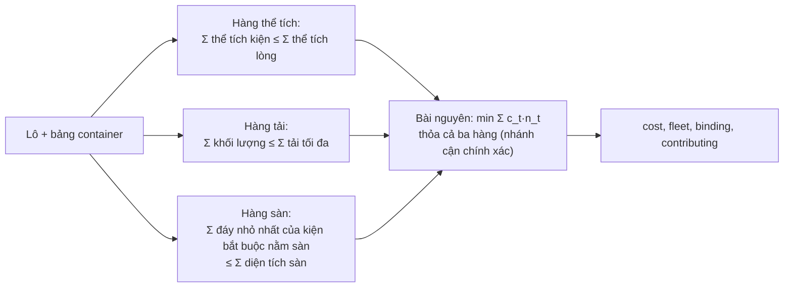

# Cận dưới của cước

> Một phần của [đặc tả engine](README.md). Viết từ `src/bound.py`; code thắng khi lệch.

Cận dưới là cước nhỏ nhất mà **mọi** phương án hợp lệ phải trả: không phương án nào rẻ hơn. Dùng ở ba chỗ: màn Kết quả hiện nó cạnh cước; E5 dừng tìm kiếm khi cước chạm nó ([e5.md](e5.md)); ALNS dừng khi chạm nó ([alns.md](alns.md)). Module không import code giải nào.

## 1. Ba hàng nới lỏng

Mỗi hàng bỏ bớt ràng buộc của bài thật (hoặc bỏ qua một đại lượng chỉ làm việc xếp khó hơn), nên đội xe nào xếp được lô thật cũng thỏa hàng đó:

| Hàng | Điều kiện trên số container `n_t` mỗi loại |
|---|---|
| Thể tích | Tổng thể tích kiện ≤ `Σ n_t · L_t·W_t·H_t`. Bỏ qua hình dạng, khe, tư thế |
| Tải | Tổng khối lượng kiện ≤ `Σ n_t · Q_t`. Bỏ qua hình dạng |
| Sàn | Tổng diện tích đáy của các kiện **bắt buộc nằm sàn** ≤ `Σ n_t · L_t·W_t`. Bỏ `δ` |

**Kiện bắt buộc nằm sàn:** kiện có `tiers = 1`, hoặc không kiện nào khác trong lô gánh được nó (mọi kiện khác có `tiers = 1` hoặc `load` nhỏ hơn khối lượng nó; dòng của chính nó chỉ tính là chỗ đỡ khi `qty ≥ 2`). Lý do: không nằm sàn thì kiện tựa lên một kiện `i`, ràng buộc 8 đòi `load_i ≥` khối lượng nó và chồng qua `i` có ít nhất 2 kiện, nên `tiers_i ≥ 2`. Các kiện nằm sàn không chồng lên nhau theo `x-y`, nên tổng đáy của chúng phải vừa tổng sàn. Kiện được lật lấy mặt nhỏ nhất trong ba mặt làm đáy; kiện chỉ đứng lấy `L × W`. Hàng này chỉ so diện tích: không thấy được chuyện hai kiện rộng không đặt cạnh nhau theo chiều ngang.

## 2. Giải

`min Σ c_t · n_t` sao cho cả ba hàng được thỏa, `n_t` nguyên không âm. Giải **chính xác** bằng nhánh cận trên các loại container (chỉ vài loại, nên liệt kê đúng rẻ hơn thêm một bộ giải MIP):

- Lời giải ban đầu: làm tròn nghiệm LP gần tối ưu.
- Mỗi nút cắt bằng cận đối ngẫu LP (cho các hàng gộp lại, chặt hơn từng hàng riêng).
- Rẽ nhánh thử giá trị gần lời giải đương nhiệm trước; loại cuối không rẽ nhánh mà lấy số nhỏ nhất thỏa phần còn lại.

Các mẹo này chỉ làm nhanh; phép đệ quy vẫn chứng minh giá trị trả về là nhỏ nhất.

## 3. Báo cáo

| Trường | Ý nghĩa |
|---|---|
| `cost`, `fleet` | Cận dưới và đội xe đạt nó (`{loại: số}`) |
| `binding` | Hàng nào một mình giải thích cận: `volume`, `mass`, `floor`, `mixed` (cần nhiều hàng), `none` (lô rỗng) |
| `rows` | Cận của từng hàng khi giải riêng |
| `contributing` | Các hàng mà bỏ đi thì cận thấp hơn |

Cận thường không đạt được vì bỏ qua hình học: ví dụ lô probe có cận 2 500 USD (1 × 40HC, theo thể tích) nhưng E5 tìm được 4 600 USD ([README](README.md#5-số-đo-đã-có)). Khoảng cách tới cận không phải khoảng cách tới tối ưu.
