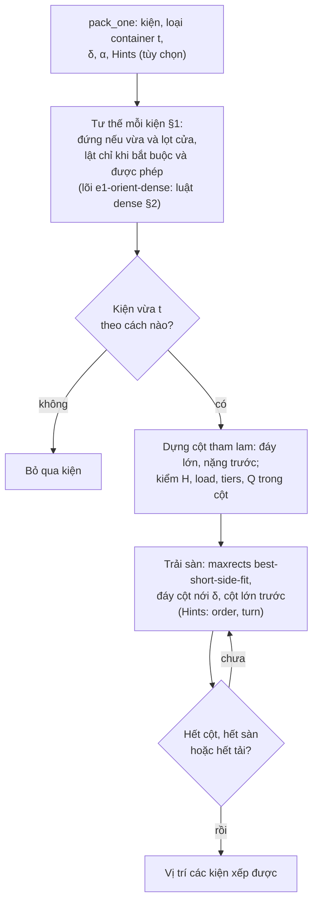

# Lõi E1: chồng trước, trải sàn sau

> Một phần của [đặc tả engine](README.md). Code thắng khi lệch.

> Một phần của [đặc tả engine của service](README.md). E5 gọi lõi này ở lời giải ban đầu, ALNS, pricing và bước xếp lại ([e5](e5.md)). Tập con nghiệm lõi này tìm: [README](README.md#tập-con-nghiệm-mỗi-lõi-tìm).

Luồng chạy (chi tiết ở các mục dưới):

## 1. Luật xếp

"Chồng trước, trải sàn sau". Giao diện: `pack_one(items, ctype, params, rng, hints=None)` xếp **một container rỗng** loại `ctype`, trả vị trí các kiện xếp được (`src/engines/e1/`). Tất định, `rng` không dùng.

1. **Tư thế** (`orientation.py`, `base_orientation`). Kiện đứng (`LWH` hoặc `WLH`) nếu có tư thế đứng vừa lòng và lọt cửa loại `ctype` (ràng buộc 4, 9). Chỉ khi không có, và tập tư thế được phép của dòng có tư thế lật ([technical-spec §1](../../reference/constraints.md#3-tư-thế)), mới lật: nằm lên cạnh cho chiều đứng thấp nhất mà vẫn vừa. Mã trả về luôn thuộc tập được phép. Kiện không vừa `ctype` theo cách nào thì bị bỏ qua.
2. **Dựng cột** (`columns.py`). Kiện duyệt theo diện tích đáy giảm dần, rồi khối lượng giảm dần, rồi thứ tự nhập. Kiện đặt lên một cột có sẵn khi: đáy kiện nằm gọn trong mặt trên kiện đỉnh (xoay 90° quanh trục đứng được); chiều cao cột ≤ `H_t`; mọi kiện trong cột còn đủ `load` cho khối lượng kiện mới; số kiện trong cột ≤ `tiers` nhỏ nhất trong cột kể cả kiện mới; khối lượng cột ≤ `Q_t`. Nhiều cột thỏa thì lấy cột có mặt trên nhỏ nhất, rồi cột cao nhất; cùng trạng thái chồng thì lấy cột mở sau cùng. Không cột nào thỏa thì mở cột mới. Mọi kiện trong cột chung góc `(x, y)`, nên kiện trên nằm gọn trong mặt trên kiện dưới: đỡ 100%, ràng buộc 7 đúng với mọi `α`.
3. **Trải sàn** (`pack.py`, `maxrects.py`). Đáy cột và sàn cùng nới `δ` theo `x`, `y`: hai cột không chồng nhau trên sàn nới thì cách nhau ≥ `δ`, còn sát vách thì được (ràng buộc 5). Cột xếp theo thể tích giảm dần bằng **maxrects, best-short-side-fit** (Jylänki 2010): chỗ có phần dư theo cạnh ngắn nhỏ nhất, hòa thì cạnh dài, rồi hình chữ nhật tìm thấy trước. Cột xoay 90° chỉ khi đáy theo hướng đó vẫn lọt cửa (ràng buộc 9). Cột làm vượt `Q_t` (ràng buộc 6) hoặc không vừa chỗ nào thì bỏ qua, thử cột sau. Dừng khi hết cột, hết sàn trống, hoặc tải còn lại nhỏ hơn cột nhẹ nhất.
4. **Gợi ý `Hints`** (`src/engines/base.py`), dùng ở pricing và ALNS. Chỉ bước trải sàn nhận gợi ý; dựng cột không đổi. Cột nhận gợi ý của dòng kiện đáy. `order`: cột trải theo khóa gợi ý trước, thể tích giảm dần sau. `turn`: cột chỉ thử hướng ưu tiên (nếu lọt cửa), không vừa chỗ nào mới thử hướng kia. Không truyền gợi ý thì chạy đúng các luật trên.
5. **Dung sai hình học** 1e-9 m, chặt hơn dung sai 1e-6 m của checker.

## 2. Luật tư thế `dense`

Chỉ dùng trong lõi `e1-orient-dense` của `e5-orient` ([e5 §4](e5.md#4-tùy-chọn-e5-orient)). Lõi này là E1 với luật `dense` thay luật tư thế thường ở bước 1; dựng cột và trải sàn y như [§1](#1-luật-xếp).

Luật `dense` (`dense_orientation`): với mỗi dòng và loại container, trong các tư thế được phép (xoay 90° nếu cửa cần) lọt lòng và cửa, chọn tư thế xếp được nhiều kiện nhất mỗi m² sàn: `mật độ = n ÷ ((fx + δ)(fy + δ))`, `n = min(tiers, ⌊H_t ÷ h⌋, n_load)`, `n_load = 1 + ⌊load ÷ m⌋` khi `load` có số (1 khi `load` = 0, không giới hạn khi để trống). Hòa thì tư thế đứng, rồi thứ tự của luật thường.

## 3. Hằng

Không có núm chỉnh ngoài `δ`, `α` từ người gọi và `Hints`. `e1/*.EPS` = 1e-9 m: dung sai hình học.
