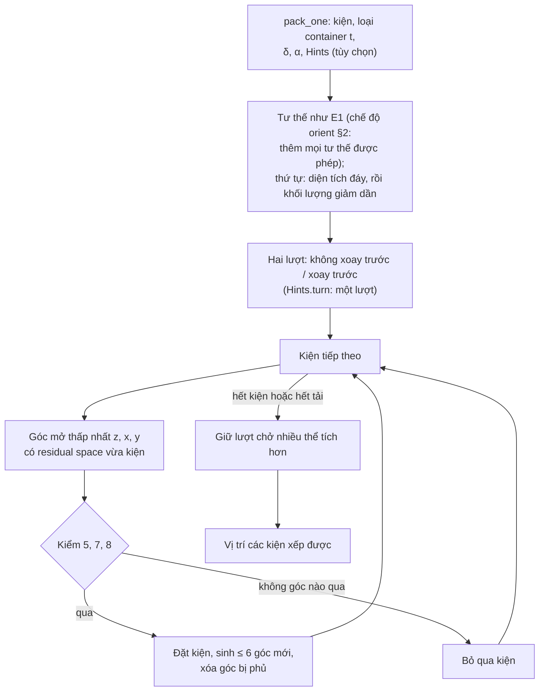

# Lõi E2: extreme point

> Một phần của [đặc tả engine](README.md). Code thắng khi lệch.

> Một phần của [đặc tả engine của service](README.md). E5 gọi lõi này ở lời giải ban đầu, ALNS, pricing và bước xếp lại ([e5](e5.md)). Tập con nghiệm lõi này tìm: [README](README.md#tập-con-nghiệm-mỗi-lõi-tìm).

Luồng chạy (chi tiết ở các mục dưới):

## 1. Luật xếp

Extreme point theo Crainic, Perboli và Tadei (2008). Cùng giao diện `pack_one` (`src/engines/e2/`), tất định.

1. **Thứ tự kiện:** như E1 (diện tích đáy giảm dần, khối lượng giảm dần, thứ tự nhập). Mỗi kiện thử một lần; không đặt được thì bỏ qua, thử kiện sau. Kiện làm vượt `Q_t` bị bỏ qua; dừng khi tải còn lại nhỏ hơn kiện nhẹ nhất hoặc hết góc.
2. **Tư thế:** của E1 (`base_orientation`), cộng phép xoay 90° quanh trục đứng nếu lọt cửa (ràng buộc 9) và đáy không vuông. Chế độ `orient`: [§2](#2-chế-độ-orient).
3. **Góc mở.** Đáy mỗi kiện và sàn nới `δ` theo `+x`, `+y` (như E1); chiều cao không nới. Kiện mới đặt sinh tối đa 6 góc theo phép chiếu của Crainic, mỗi góc trượt tới mặt gần nhất của kiện chắn hoặc tới vách, sàn. Bỏ góc ngoài container, góc trong một kiện (kể cả dải `δ`), góc trùng; góc bị kiện mới phủ thì xóa. Mỗi góc giữ *residual space* `(rx, ry, rz)` (khoảng tới mặt kiện hoặc vách gần nhất theo `+x`, `+y`, `+z`) chỉ để lọc cặp (góc, hướng) và xóa góc chết (nhỏ hơn cạnh hoặc chiều cao nhỏ nhất của mọi kiện trong lần gọi).
4. **Chọn góc:** trong các cặp (góc, hướng) mà kiện nằm gọn trong residual space, lấy `z` nhỏ nhất, rồi `x`, rồi `y`, rồi hướng ưu tiên của lượt; cặp đầu tiên theo thứ tự đó qua được phép kiểm chính xác thì được đặt.
5. **Hai lượt.** Mỗi lần gọi xếp container hai lượt độc lập: lượt một ưu tiên hướng không xoay, lượt hai ưu tiên hướng xoay (khi hai hướng hòa ở cùng một góc). Giữ lượt chở nhiều thể tích hơn, hòa thì nhiều kiện hơn, hòa nữa thì lượt không xoay trước. Tốn gấp đôi thời gian.
6. **Kiểm chính xác** (`layout.py`) theo đúng luật và dung sai của checker nhưng không import checker, cho mỗi cặp ứng viên: ràng buộc 5 (không giao, khe ≥ `δ` giữa kiện có khoảng `z` giao nhau); ràng buộc 7 (nằm sàn, hoặc diện tích giao với mặt trên các kiện có đỉnh chạm đáy kiện, dung sai 1e-6 m, ≥ `α` × diện tích đáy); ràng buộc 8 (mỗi kiện dưới, trực tiếp hay gián tiếp, gánh trọn khối lượng kiện mới và mọi kiện tựa lên nó, còn đủ `load`; số tầng `dưới + trên − 1 ≤ tiers` cho kiện mới và mọi kiện so sánh được với nó). Kiện mới lấp khe dưới một kiện nhô thì gánh kiện nhô: checker coi nó tựa lên kiện mới, lõi tính đúng như vậy.
7. **Gợi ý `Hints`:** `order` đưa kiện vào theo khóa của dòng trước, thứ tự E1 sau (vẫn hai lượt). `turn` xếp **một** lượt, mỗi kiện ưu tiên hướng của dòng mình khi hai hướng hòa ở cùng góc. Không gợi ý thì hai lượt như trên.
8. **Tốc độ** (không đổi kết quả): kiểm va chạm và đỡ vector hóa bằng numpy theo lô ứng viên (32, mỗi lô sau gấp 4); lọc rẻ trước ràng buộc 8; kiện giống hệt vừa thất bại thì bỏ qua tới khi có kiện được đặt.
9. **Dung sai:** 1e-9 m cho va chạm và residual space; 1e-6 m cho quan hệ "tựa lên", đúng dung sai checker.

## 2. Chế độ `orient`

Dùng khi `e5-orient` bật `e2_orient` ([e5 §4](e5.md#4-tùy-chọn-e5-orient)): lõi E2 là `pack_one_orient` ở mọi chỗ (lời giải ban đầu, ALNS, pricing, xếp lại). Mỗi kiện, ngoài tư thế gốc và phép xoay của nó, thử thêm mọi tư thế được phép khác lọt cửa và lòng container (đứng trước, rồi lật theo chiều đứng thấp trước), mỗi tư thế kèm phép xoay 90°. Luật chọn góc giữ nguyên, nên kiện chỉ lật ở nơi tư thế gốc không đặt được hoặc đặt cao hơn. Thứ tự kiện vẫn theo tư thế gốc.

## 3. Hằng

Không có núm chỉnh ngoài `δ`, `α` từ người gọi và `Hints`. Hằng không đổi kết quả hoặc chỉ là dung sai:

| Tên trong code | Giá trị | Ý nghĩa |
|---|---|---|
| `e2/layout.EPS` | 1e-9 m | Dung sai va chạm và residual space của E2 |
| `e2/layout.TOUCH` | 1e-6 m | Dung sai "tựa lên", khớp checker |
| `e2/pack.FIRST_BATCH` | 32 | Số ứng viên kiểm lô đầu, mỗi lô sau gấp 4 (chỉ tốc độ) |
