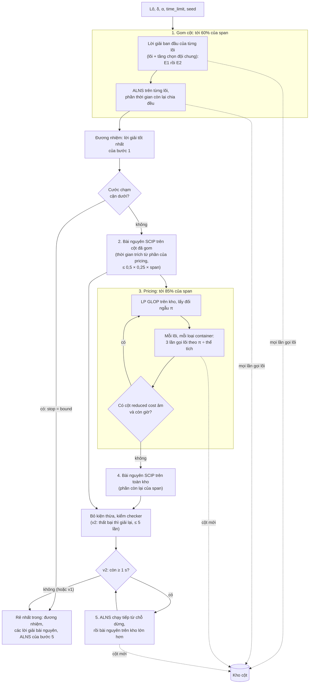

# E5: set cover trên container của lõi E1, E2 và ALNS

> Một phần của [đặc tả engine](README.md). Code thắng khi lệch.

> Một phần của [đặc tả engine của service](README.md) (phạm vi, tập con nghiệm, code ở đâu). Lõi: [core-e1](core-e1.md), [core-e2](core-e2.md); tìm kiếm: [alns](alns.md).

Luồng chạy (chi tiết ở các mục dưới):



Đặc tả này mô tả bốn phiên bản: **`e5-v4`**, mặc định từ (v3 cộng luật dừng ALNS khi chững); **`e5-v3`**, mặc định từ (mỗi bước giữ mốc thời gian, bài nguyên trên kho cột đã gọn); **`e5-v2`**, mặc định của (tăng giới hạn thời gian không làm cước đắt hơn); và **`e5-v1`**, E5 trước đó. Chỗ các bản khác nhau ghi "v1", "v2", "v3", "v4"; v3 là v2 cộng hai nhóm thay đổi, v4 là v3 cộng luật chững, nên "v2" áp cho cả v3 và v4 trừ khi nói khác; còn lại chung. Sơ đồ vẽ luồng v2; v3 thêm hạn giờ từng bước và gọn kho cột ([§2](#2-luồng-chạy-và-chia-thời-gian), [§3.2](#32-bài-chính)).

## Mục lục

| # | Mục |
|---|---|
| 1 | [Hợp đồng](#1-hợp-đồng) |
| 2 | [Luồng chạy và chia thời gian](#2-luồng-chạy-và-chia-thời-gian) |
| 3 | [Chọn đội: bài chính, pricing, bỏ kiện thừa, kiểm](#3-chọn-đội-bài-chính-pricing-bỏ-kiện-thừa-kiểm) |
| 4 | [Tùy chọn `e5-orient`](#4-tùy-chọn-e5-orient) |
| 5 | [Tham số](#5-tham-số) |
| 6 | [Thông tin chạy](#6-thông-tin-chạy) |
| 7 | [Giới hạn đã biết](#7-giới-hạn-đã-biết) |

## 1. Hợp đồng

Giao diện chung của mọi engine: `solve(instance, params, time_limit, seed) -> (Solution, dict)` (`src/engines/base.py`). Engine lấy từ bộ đăng ký theo tên: `base.get("e5")`, `base.get("e5-orient")` chạy phiên bản mặc định (`e5-v4`); `e5-v1`, `e5-v2`, `e5-v3`, `e5-v4`, `e5-orient-v1`, `e5-orient-v2`, `e5-orient-v3`, `e5-orient-v4` chạy đúng một phiên bản. Phiên bản là một `Settings` cố định (`VERSIONS` trong `src/engines/e5/engine.py`).

| | |
|---|---|
| **Vào** | Một lô: dòng kiện và loại container kèm bảng cước, định nghĩa ở [constraints.md](../../reference/constraints.md#3-tư-thế). Lô phải hợp lệ (mỗi dòng vừa ít nhất một loại container) |
| **Tham số mô hình** | `δ` (khe hở), `α` (tỉ lệ đỡ tối thiểu): [constraints.md](../../reference/constraints.md#3-tư-thế). Engine nhận hai số này từ người gọi, không đọc từ file |
| **`time_limit`** | Giây. Engine lập kế hoạch tới `0,95 × time_limit` ([§2](#2-luồng-chạy-và-chia-thời-gian)) và **có thể chạy quá** ([§7](#7-giới-hạn-đã-biết)). Người gọi đặt giới hạn cứng riêng, cao hơn |
| **`seed`** | Số nguyên. Chỉ ALNS và nhiễu thứ tự của pricing dùng (cả hai `random.Random(seed)`). Lõi E1, E2 và tầng chọn đội không dùng. Cùng seed vẫn **không** cho cùng kết quả ([§7](#7-giới-hạn-đã-biết)) |
| **`start`** | Tùy chọn, `Solution` đã có của cùng lô. Hợp lệ (checker, theo `δ`, `α` của lần chạy) thì container của nó vào kho cột, nó là một ứng viên (cước trả về không cao hơn; không có gì rẻ hơn thì trả lại đúng nó) và ALNS của mỗi lõi khởi động từ nó khi nó rẻ hơn lời giải ban đầu của lõi. Không hợp lệ thì bỏ qua. Thông tin chạy `start`: `used` / `invalid`. Chỉ `e5`, `e5-v1`, `e5-v2`, `e5-v3`, `e5-v4` và `e5-orient*` nhận |
| **Ra** | `Solution` ([constraints.md](../../reference/constraints.md)): container dùng và vị trí, tư thế từng kiện |
| **Thông tin chạy** | `dict` tự do, mục [§6](#6-thông-tin-chạy) |
| **Lỗi** | `fleet.FleetTimeout` khi không lõi nào ra được lời giải ban đầu trong phần thời gian của nó (không có lời giải). `ValueError` khi tham số nội bộ sai (không xảy ra qua engine đã đăng ký) |

**Mọi lời giải trả về phải qua checker độc lập** (`src.checker.check`; ràng buộc 1–9 ở [constraints.md](../../reference/constraints.md#1-chín-ràng-buộc)). Engine chỉ tự chạy checker trên lời giải của bài chính để chọn giữa các ứng viên ([§3.4](#34-kiểm-và-chọn-lời-giải-trả-về)); lời giải đương nhiệm không bị kiểm lại trong engine. Người gọi vẫn kiểm lời giải trả về như với mọi engine. Không bao giờ nới một luật của checker để lời giải qua.

Mục tiêu: tổng cước nhỏ nhất ([constraints.md](../../reference/constraints.md)); hòa thì container vơi nhất vơi hơn là tốt hơn. Độ đầy của một container = max(thể tích kiện ÷ thể tích, khối lượng ÷ `Q_t`).

## 2. Luồng chạy và chia thời gian

Sơ đồ luồng ở đầu file.

**Chia thời gian.** `span = 0,95 × time_limit`. Mỗi bước chạy tới một **mốc tuyệt đối** tính từ đầu `solve`, nên bước xong sớm để thời gian lại cho bước sau:

| Bước | Tới mốc | Ví dụ `time_limit` = 60 s (span 57 s) |
|---|---|---|
| 1. Gom cột | `0,60 × span` | 34,2 s |
| 2–3. Bài nguyên trước pricing, pricing | `(0,60 + 0,25) × span` | 48,45 s |
| 4. Bài nguyên cuối | `span` | 57 s |

Trong bước 1: lời giải ban đầu của E1 chạy tới mốc gom cột, rồi của E2 cũng tới mốc đó (E2 nhận phần còn lại sau E1). **v2:** từ `time_limit` 30 s (`initial_to_end_from`), lời giải ban đầu được chạy tới cuối `span` thay vì mốc gom cột; phần vượt mốc lấy vào thời gian của ALNS, rồi của pricing. Dưới 30 s như v1: ở 10 s, E2 trên lô S c40 không kịp xong nên chạy tiếp chỉ ăn thời gian của các bước sau. Mỗi lời giải ban đầu là `fleet.solve`: tầng chọn đội chung chia thời gian của nó đều cho các loại container và bỏ loại nào không xong ([`fleet.py`](../../../src/engines/fleet.py)). Lõi không xong loại container nào thì không có cột từ lõi đó và không có ALNS trên nó; E5 chạy tiếp với lõi còn lại. Không lõi nào xong thì `FleetTimeout`. Phần còn lại tới mốc gom cột chia đều cho ALNS của các lõi có lời giải ban đầu; ALNS dừng sớm khi cước tốt nhất chạm cận dưới của lô (`src/bound.py`), và từ v4 khi chững (xem dưới).

**v4: ALNS dừng khi chững**: ALNS của mỗi lõi dừng (`stop` = `stall`) khi số vòng kể từ lần tốt lên cuối vượt `max(alns_stall_min, alns_stall_ratio × vòng của lần tốt lên cuối)`, tức `max(2 000, 2 × …)`. Đếm theo vòng, không theo giây: cùng seed dừng cùng chỗ, không phụ thuộc tốc độ máy. Thời gian ALNS dừng sớm không trả lại cho người dùng ở lô lớn: theo mốc tuyệt đối, nó dồn cho pricing và bài nguyên.

ALNS trên từng lõi nhận lời giải theo `anneal` ở v1, `flat` 0,2 × T0 ở v2 ([alns §1](alns.md#1-cách-chạy)).

Bài nguyên ở bước 2 được tối đa `0,5 × 0,25 × span` giây, và không quá phần còn lại tới mốc pricing.

**v3: mỗi bước giữ mốc của nó** (`pace`):
- LP và bài nguyên dựng thưa; hạn của SCIP đã trừ thời gian dựng mô hình; GLOP có hạn giờ (phần còn lại tới mốc pricing).
- Dành chỗ cho bài nguyên cuối: thời gian dựng của bài nguyên lần trước cộng `PACE_MIN_SOLVE` (1 s), cộng thời gian gọn kho nếu có. Pricing dừng trước phần này, và không mở vòng mới khi thời gian còn lại ít hơn thời gian LP lần trước (`stop = pace`). Còn dưới phần dành chỗ thì bài nguyên cuối bị bỏ (`final.skipped = pace`) và trả lời giải tốt nhất đã có; bước 5 cũng không bắt đầu vòng khi còn dưới phần này cộng `reuse_min`.
- LP giải một lần trước bài nguyên bước 2, để có đối ngẫu cho việc gọn kho (`pre_lp`); vòng pricing đầu dùng lại nó khi kho chưa lớn thêm. Ở lô B, LP này chiếm phần thời gian của pricing nên từ 30 s pricing thường không chạy vòng nào.

**Thời gian thừa ở cuối.** **v1:** không dùng lại: pricing hết cột hoặc bài nguyên cuối giải xong sớm thì E5 trả kết quả ngay. **v2:** bài nguyên cuối xong mà còn ít nhất `reuse_min` (1 s) thì vào **bước 5**, lặp:
1. ALNS của từng lõi chạy tiếp đúng từ chỗ đã dừng (cùng trạng thái, cùng luồng số ngẫu nhiên) trong `alns_share` (60%) của phần còn lại, chia đều cho các lõi; mọi lần gọi lõi vào kho.
2. Bài nguyên chạy lại trên kho lớn hơn tới cuối `span`, gợi ý bằng lời giải rẻ nhất đã biết, rồi bỏ kiện thừa và kiểm như bước 4.

Dừng khi còn dưới `reuse_min`, cước chạm cận dưới, không ALNS nào chạy tiếp được, hoặc một vòng không thêm cột. **v4:** lõi đã dừng vì chững không chạy tiếp; mọi lõi đều đã dừng thì bỏ bước 5 (`reuse.stop` = `stall`). Bước 5 không chạy pricing lại.

## 3. Chọn đội: bài chính, pricing, bỏ kiện thừa, kiểm

### 3.1. Kho cột

Cột = một container lõi đã xếp thật: loại container, số kiện mỗi dòng, và một cách xếp đúng số đó (`pool.py`). Kiện cùng dòng giống hệt nhau nên bài chính chỉ nhìn (loại, số kiện mỗi dòng); hai cột trùng cặp này thì giữ cột đầu. Cột lấy từ: lời giải ban đầu của mỗi lõi (mọi lần tầng chọn đội gọi lõi, tức cả phương án theo từng loại container, không chỉ phương án được giữ); ALNS ([alns §1](alns.md#1-cách-chạy)); pricing và bước xếp lại khi bỏ kiện thừa. Không có cột từ E0.

### 3.2. Bài chính

```
min   Σ_p c_t(p) · x_p
s.t.  Σ_p a_ip · x_p ≥ qty_i      (mọi dòng i)
      x_p ≥ 0 (LP) / x_p nguyên, 0 ≤ x_p ≤ max_i ⌈qty_i ÷ a_ip⌉ (nguyên)
```

**v3: bài nguyên giải trên kho đã gọn** (`reduce_master`). Kho vẫn giữ mọi cột cho pricing và ALNS, và lưu thưa (`sparse_pool`: chỉ các cặp dòng, số kiện khác 0). Trước mỗi bài nguyên: (1) bỏ cột bị trội (cùng loại container, có cột khác chứa không ít hơn ở mọi dòng; giá trị tối ưu không đổi), pass này dừng ở hạn `REDUCE_SHARE` (0,25) của thời gian bài nguyên; (2) còn quá `master_columns` (20 000) cột thì giữ 20 000 cột có reduced cost thấp nhất theo đối ngẫu LP gần nhất. Cột của đương nhiệm và của lời giải rẻ nhất đã biết luôn được giữ, nên gợi ý còn khả thi. Cắt còn N có thể bỏ cột mà lời giải rẻ hơn cần.

`a_ip` = số kiện dòng `i` trong cột `p`. Phủ `≥ qty` nên đối ngẫu không âm và bài nguyên khả thi mỗi khi kho phủ được từng dòng; kiện dư bỏ sau ([§3.4](#34-kiểm-và-chọn-lời-giải-trả-về)). LP giải bằng **GLOP**, bài nguyên bằng **SCIP**, cả hai một luồng, qua OR-Tools (`master.py`). Bài nguyên nhận lời giải đã biết làm gợi ý; thời gian SCIP tối thiểu 100 ms.

**Nguồn.** Set cover trên các cách xếp một container theo Eley (2003); nhiều loại container, tối thiểu cước: Che (2011), Zhu, Huang (2012), Wei (2015).

**Tên gọi.** Bài này hay được gọi là set partitioning; mô hình là set cover (`≥ qty`), kết quả chở đúng `qty` nhờ bỏ kiện thừa. Đổi sang `=` thường làm bài không khả thi (cột của lõi tham lam hiếm khi cộng vừa khít `qty`) và làm mất dấu `π ≥ 0` mà pricing dựa vào.

Giá trị LP và cận SCIP **không phải cận dưới của lô**: cột sinh bằng lõi heuristic và pricing không chứng minh được hết cột reduced cost âm. Chúng chỉ nói kho cột này làm được tới đâu.

### 3.3. Pricing

Chạy sau bài nguyên trên cột đã gom ([§2](#2-luồng-chạy-và-chia-thời-gian) bước 2: ghi riêng để biết riêng chọn đội trên cột đã gom bớt được bao nhiêu). Lặp tới mốc pricing:

1. Giải LP trên toàn kho (dựng lại từ đầu mỗi vòng), lấy đối ngẫu `π_i ≥ 0`. LP không có nghiệm tối ưu (kho không phủ một dòng) thì dừng, `stop = lp`.
2. Với mỗi lõi đang dùng và mỗi loại container (rẻ trước): lấy các dòng có `π_i > 10⁻⁹` và vừa loại đó (`fits_container`), xếp theo `π_i ÷ thể tích một kiện` giảm dần (hòa theo thứ tự nhập). Đưa kiện theo thứ tự đó cho tới khi tổng thể tích đạt `price_volume` × thể tích container, hoặc tổng khối lượng đạt `price_volume` × `Q_t`.
3. Gọi lõi **ba lần** trên tập kiện đó, với `Hints.order` theo hạng ở bước 2 và ba biến thể: (a) không `turn`; (b) `turn` xoay mọi dòng; (c) hạng cộng nhiễu chuẩn độ lệch `price_noise`. Mọi kết quả vào kho.
4. Cột mới có reduced cost `c_t − Σ π_i a_i < −10⁻⁶` được đếm là "cột mới". Dừng khi hết thời gian pricing (một vòng đang chạy dở bị cắt tại lần gọi lõi kế), hoặc một vòng không có cột mới (`stop = no_column`).

Pricing là heuristic: thứ tự theo đối ngẫu chỉ gợi ý cho lõi tham lam, không tối đa `Σ π_i a_i` thật; lõi có thể trả lại cột đã có.

**Nguồn.** Khuôn column generation: Gilmore, Gomory (1961); price-and-branch: Lübbecke, Desrosiers (2005). Sinh cột cho nhiều loại container bằng knapsack trên đối ngẫu: Zhu, Huang (2012), Wei (2015).

### 3.4. Kiểm và chọn lời giải trả về

Bài nguyên chạy hai lần: **bước 2** trên cột đã gom, **bước 4** trên toàn kho (price-and-branch, gợi ý bằng lời giải rẻ nhất mà bước 2 hoặc đương nhiệm cho). Mỗi lời giải bài nguyên đi qua:

**Bỏ kiện thừa** (`trim.py`). Các container được chọn có thể chở dư kiện của một dòng. Chỉ bỏ kiện **không có gì tựa lên** (không kiện nào có đáy chạm mặt trên của nó trong dung sai 1e-6 m và chân đế chồng lấn): bỏ nó thì không kiện nào mất đỡ, tải và số tầng bên dưới chỉ giảm, khe chỉ rộng ra, container chỉ nhẹ đi, nên mọi ràng buộc còn đúng. Trong các kiện đó của dòng dư, bỏ kiện đặt cao nhất trước (hòa: container đầu, rồi kiện đầu). Quét lặp các dòng tới khi hết dư hoặc một lượt quét không bỏ được gì (bỏ kiện dư của dòng sau có thể giải phóng kiện dư của dòng trước nằm dưới nó). Container rỗng thì bỏ.

**Dự phòng: xếp lại container.** Còn dư mà mọi kiện dư đều đang đỡ kiện khác thì, với từng container chở dòng đó (container chở nhiều kiện của dòng trước), gọi lõi xếp lại **từ đầu** vào container rỗng cùng loại đúng tập kiện của nó trừ phần dư (không gợi ý; lõi theo thứ tự E1, E2, rồi lõi thêm của `e5-orient`); chỉ thay khi lõi xếp hết. Kết quả xếp lại cũng vào kho. Vẫn còn dư thì lời giải bài nguyên đó bị loại (`trim_failed`); không nới luật nào. **v2:** khi đó bài nguyên giải lại với ràng buộc `Σ_p a_ip x_p ≤ qty_i + (số kiện dư của dòng i đã bỏ được)` cho dòng i không bỏ hết dư, cắt đúng lời giải hỏng; tối đa `trim_retries` (5) lần, trong phần thời gian còn lại của bước, không giải lại khi còn dưới 0,5 s. Không lần gọi lõi nào của bước xếp lại bắt đầu sau hạn: mốc pricing ở bước 2, `span + 1,5 s` ở bước 4.

**Nguồn.** Bỏ kiện không đỡ kiện nào trước, hỏng thì xếp lại container: như Eley (2003) và Wei (2015).

**Kiểm.** Lời giải sau khi bỏ kiện đi qua `src.checker.check` ngay trong engine; không qua thì bị loại, không sửa.

**Chọn.** Lời giải trả về là lời giải rẻ nhất (cước, rồi container vơi nhất vơi hơn) trong: đương nhiệm, bài nguyên bước 2, bài nguyên bước 4, và ở v2 các lời giải của bước 5 (bài nguyên, ALNS tốt hơn đương nhiệm). Hòa thì giữ đương nhiệm. Do đó cước trả về không bao giờ cao hơn cước tốt nhất của bước gom cột.

## 4. Tùy chọn `e5-orient`

Mặc định E5 chỉ lật kiện khi bắt buộc (không đứng lọt container hoặc cửa). `e5-orient` cho engine **tự chọn tư thế** trong tập tư thế được phép của từng dòng ([constraints.md](../../reference/constraints.md#3-tư-thế)); service bật mặc định, nhưng chỉ an toàn khi lô khai tập tư thế theo từng dòng (khóa `orientations`): dòng chỉ ghi `tippable` thì engine dùng cả sáu tư thế, kể cả dựng cao (mục Hệ quả). `e5-orient` = phiên bản mặc định cộng `orient_dense_core=True, e2_orient=True` (`e5-orient-v1`, `e5-orient-v2`, `e5-orient-v3` cho từng phiên bản); mọi thứ khác như phiên bản đó. `e5-orient-v2` và `e5-orient-v3` chưa đo riêng.

- **`orient_dense_core`:** thêm lõi `e1-orient-dense` vào lời giải ban đầu, pricing và bước xếp lại khi bỏ kiện thừa, **không** vào ALNS (thời gian ALNS vẫn chia cho đúng hai lõi E1, E2). Chỉ thêm khi luật dense đặt tư thế khác luật thường ở ít nhất một dòng và một loại container (`dense_changes`). Lõi này là E1 với luật tư thế `dense`: [core-e1 §2](core-e1.md#2-luật-tư-thế-dense).
- **`e2_orient`:** lõi E2 là `pack_one_orient` ở mọi chỗ (lời giải ban đầu, ALNS, pricing, xếp lại): [core-e2 §2](core-e2.md#2-chế-độ-orient).
- **Thông tin chạy thêm:** [§6](#6-thông-tin-chạy).

## 5. Tham số

Mặc định lấy từ code, `Settings` ở `src/engines/e5/engine.py`; mặc định của `Settings` là `e5-v1` (các biến thể nhánh `e5-brkga`, `e5-knap`, … dựng trên nó), `e5-v2` đặt năm tham số đánh dấu "v2", `e5-v3` đặt thêm bốn tham số đánh dấu "v3", `e5-v4` đặt thêm hai tham số đánh dấu "v4". Phiên bản mặc định: `e5-v4` (`DEFAULT_VERSION`). Cột "Dùng" ghi rõ: **service** = giá trị service chạy; **đo / test** = chỉ để đo hoặc test, service không đặt. Tham số ALNS: [alns §2](alns.md#2-tham-số); hằng của lõi: [core-e1 §3](core-e1.md#3-hằng), [core-e2 §3](core-e2.md#3-hằng).

| Tên trong code | Mặc định | Ý nghĩa | Dùng |
|---|---|---|---|
| `time_share` | 0,95 | Phần `time_limit` dùng làm `span` (chừa khởi động tiến trình, ghi lời giải) | service |
| `alns_share` | 0,60 | Phần `span` cho bước gom cột (lời giải ban đầu + ALNS) | service |
| `pricing_share` | 0,25 | Phần `span` cho bài nguyên trước pricing và pricing; bài nguyên cuối nhận phần còn lại (0,15) | service |
| `pre_mip_share` | 0,5 | Tối đa bao nhiêu phần của `pricing_share × span` cho bài nguyên trước pricing | service |
| `price_volume` | 2,0 | Mỗi lần gọi pricing nhận kiện tới tổng thể tích (hoặc khối lượng) bằng ngần này lần của container | service |
| `price_noise` | 1,0 | Độ lệch chuẩn (đơn vị hạng) của biến thể thứ tự có nhiễu ở pricing | service |
| `orient_dense_core` | `False` | Thêm lõi `e1-orient-dense` ([§4](#4-tùy-chọn-e5-orient)) | `e5-orient`: `True` |
| `e2_orient` | `False` | Lõi E2 thử mọi tư thế được phép ([§4](#4-tùy-chọn-e5-orient)) | `e5-orient`: `True` |
| `cores` | `("e1", "e2")` | Lõi dùng trong gom cột, pricing, xếp lại; tập con khác rỗng của `CORES` | service: cả hai. Một lõi: đo (`e5-e1`, `e5-e2`) |
| `search` | `"alns"` | Tìm kiếm trên từng lõi khi gom cột: `"alns"` hoặc `"brkga"` | service: `alns`. `brkga`: đo |
| `tilt_core` | `False` | Thêm lõi `e1-tilt` (ưu tiên nằm xuống) | đo (`e5-tilt`) |
| `initial_to_end` | `False` | Lời giải ban đầu chạy tới cuối `span` thay vì mốc gom cột, từ `initial_to_end_from` ([§2](#2-luồng-chạy-và-chia-thời-gian)) | v2: `True` |
| `initial_to_end_from` | 30 s | Giới hạn thời gian thấp nhất áp `initial_to_end` | v2 |
| `alns_acceptance` | `None` (giữ `anneal` của E4) | Luật chấp nhận của ALNS gom cột ([alns §1](alns.md#1-cách-chạy)) | v2: `"flat"`; `"lahc"`: đo |
| `alns_flat_temperature` | `None` (0,1 của E4) | Nhiệt độ của `flat`, × T0 | v2: 0,2 |
| `trim_retries` | 0 | Số lần giải lại bài nguyên khi bỏ kiện thừa thất bại ([§3.4](#34-kiểm-và-chọn-lời-giải-trả-về)) | v2: 5 |
| `reuse_time` | `False` | Bước 5: dùng lại thời gian bài nguyên cuối để thừa ([§2](#2-luồng-chạy-và-chia-thời-gian)) | v2: `True` |
| `reuse_min` | 1,0 s | Không vào vòng mới của bước 5 khi còn ít hơn | v2 |
| `pace` | `False` | Mỗi bước giữ mốc thời gian: dựng thưa, hạn SCIP trừ thời gian dựng, GLOP có hạn, dành chỗ cho bài nguyên cuối ([§2](#2-luồng-chạy-và-chia-thời-gian)) | v3: `True` |
| `sparse_pool` | `False` | Kho lưu mỗi cột thưa (chỉ cặp dòng, số kiện khác 0); cần `pace` | v3: `True` |
| `reduce_master` | `False` | Bài nguyên giải trên kho đã gọn: bỏ cột bị trội, cắt còn `master_columns` ([§3.2](#32-bài-chính)) | v3: `True` |
| `master_columns` | 20 000 | Số cột giữ theo reduced cost sau khi bỏ cột bị trội | v3 |
| `alns_stall_min` | `None` (tắt) | ALNS của lõi dừng khi số vòng từ lần tốt lên cuối vượt `max(alns_stall_min, alns_stall_ratio × vòng của lần tốt lên cuối)` ([§2](#2-luồng-chạy-và-chia-thời-gian)) | v4: 2 000 |
| `alns_stall_ratio` | 2,0 | Tỉ lệ `r` của luật chững | v4 |
| `alns_iterations` | `None` | Giới hạn số vòng mỗi ALNS thay cho thời gian | test |
| `brkga_generations` | `None` | Giới hạn số thế hệ mỗi BRKGA | test |
| `pricing_rounds` | `None` | Giới hạn số vòng pricing | test |

Hằng của module (`engine.py`, `master.py`, `trim.py`): `MONO_FLAT_TEMPERATURE` = 0,2 (nhiệt độ `flat` của v2); `MIN_RETRY_TIME` = 0,5 s (không giải lại bài nguyên khi còn ít hơn); `PACE_MIN_SOLVE` = 1,0 s (v3: thời gian giải tối thiểu dành cho bài nguyên cuối, cộng thời gian dựng lần trước); `REDUCE_SHARE` = 0,25 (v3: phần thời gian bài nguyên tối đa cho pass bỏ cột bị trội); ngưỡng reduced cost `REDUCED_COST_TOL` = 1e-6; ngưỡng đối ngẫu dương 1e-9 (`EPS`); `REPACK_SLACK` = 1,5 s (xếp lại ở bài nguyên cuối được bắt đầu tới `span + 1,5 s`; bộ chạy dừng hẳn ở 1,5 × `time_limit`); dung sai "tựa lên" của `trim` 1e-6 m (khớp checker); thời gian SCIP tối thiểu 100 ms; một luồng cho GLOP và SCIP.

Mọi con số hiệu năng của E5 phải ghi kèm giới hạn thời gian, seed, `δ`, `α`, bảng cước.

## 6. Thông tin chạy

`dict` thứ hai của `solve`. Mọi trường là thông tin chẩn đoán; **service có thể hiện** các trường đánh dấu ★, phần còn lại để debug và đo.

| Trường | Nghĩa |
|---|---|
| `engine` | v1: `e5`, hoặc `e5-orient` khi một trong hai cờ orient bật; v2: `e5-v2`, `e5-orient-v2`; v3: `e5-v3`, `e5-orient-v3`; v4: `e5-v4`, `e5-orient-v4` ★. `e5-v2-lean` có cùng `Settings` với v3 nên ghi `e5-v3`, `e5-v3-stall` và `e5-orient-v3-stall` có cùng `Settings` với v4 nên ghi `e5-v4`, `e5-orient-v4` (như `e5-mono` ghi `e5-v2`); `e5-v2-pace` ghi `e5-v2-pace`, `version` là `null` |
| `version` ★ | Phiên bản đã chạy (`e5-v1`, `e5-v2`, `e5-v3`, `e5-v4`), dù gọi bằng tên nào; `null` với biến thể nhánh và engine thử. Run trước không có trường này: là v1 |
| `start` | Chỉ khi có truyền `start`: `used` hoặc `invalid`; `source` là `start` khi lời giải trả về chính là nó |
| `cost` ★, `bound` ★ | Cước lời giải trả về; cận dưới của lô (`src/bound.py`) theo bảng cước của lần chạy |
| `source` ★ | Lời giải trả về lấy từ đâu: `alns-e1`, `alns-e2`, `mip-harvest`, `mip-final`, `mip-reuse` (v2, bước 5); có thể là `alns-<lõi thêm>` khi đương nhiệm là lời giải ban đầu của lõi không có ALNS (`e1-orient-dense`) |
| `stop` ★ | `bound` (đương nhiệm chạm cận dưới: bỏ qua bài chính) hoặc `time` |
| `improvement_iterations`, `last_improvement_iteration`, `last_improvement_time` | Trong `<lõi>_alns` (từ v4, mọi phiên bản): số thứ tự vòng mà cước tốt nhất giảm hẳn (tối đa 1 000 phần tử, nối tiếp qua bước 5); vòng của lần tốt lên cuối (0 nếu không có); giây từ lúc bắt đầu giải (`null` nếu không có). `reuse.last_improvement_iteration` theo lõi |
| `time_harvest`, `time_total` ★ | Giây từ đầu `solve` tới hết gom cột; tới hết |
| `incumbent_cost`, `incumbent_core`, `cost_harvest` | Cước và lõi của đương nhiệm; cước tốt nhất chỉ với cột đã gom (min của đương nhiệm và bài nguyên bước 2) |
| `cores` | Danh sách lõi chọn tìm kiếm |
| `initial_deadline` | `alns_end` (hai lõi) hoặc `end` (một lõi; v2 từ 30 s) |
| `e1_initial_cost`, `e2_initial_cost`, `e1_time_initial`, `e2_time_initial` | Cước, thời gian lời giải ban đầu; cước `null` khi lõi không xong |
| `e1_alns`, `e2_alns` | Mỗi lõi: `iterations`, `improvements`, `stop` (v4 thêm `stall`), `cost`, `time`. Vắng khi ALNS của lõi đó không chạy (đã chạm cận) |
| `columns_initial`, `columns_harvested`, `columns`, `columns_by_source` | Số cột sau lời giải ban đầu, sau ALNS, cuối; theo nguồn đầu tiên sinh ra cột. Cột từ pricing và xếp lại có nguồn `alns-<lõi>` như cột ALNS |
| `pre_pricing`, `final` | Bài nguyên bước 2, bước 4: `status` (`OPTIMAL`, `FEASIBLE`, `NOT_SOLVED`), `cost` (trước bỏ kiện), `bound` (SCIP, **không phải** cận của lô), `columns`, `containers`, `time`, `trimmed_items`, `repacked_containers`, `trim_failed`, `checker_ok`, `checker_violations`, `cost_trimmed`; v2 thêm `retries` (số lần giải lại), `caps` (giới hạn trên theo dòng). Số liệu là của lần giải cuối |
| `reuse` | v2, bước 5: `rounds`, `stop` (`time`, `bound`, `search`, `no_column`; v4: `stall`), `iterations` (vòng ALNS thêm, theo lõi), `columns_added`, `masters` (mỗi lần bài nguyên: `status`, `cost`, `columns`, `time`, `cost_trimmed`), `time`. `source` của lời giải từ bước này là `mip-reuse` |
| `pricing` | `rounds`, `columns_negative`, `stop` (`no_column`, `time`, `lp`; `rounds` chỉ test), `time` |
| `lp_value_harvest`, `lp_value` | Giá trị LP ở vòng pricing đầu và cuối. **Không phải cận dưới** |
| `orient_e2`, `tilt_core`, `orient_dense_core` | Cờ lõi đã dùng (`tilt_core` luôn `False` ở service) |
| `containers_by_core`, `tipped_by_core`, `containers_from_e1_orient_dense`, `tipped_pieces` ★ | Số container của lời giải cuối theo lõi sinh cột (`e1`, `e2`, `e1-orient-dense`, `e1-tilt`, `other`); số kiện lật (tư thế không đứng) theo lõi; tổng số kiện lật. Hiện cả khi cờ orient tắt |
| `e1-orient-dense_initial_cost`, `e1-orient-dense_time_initial` | Chỉ khi lõi dense chạy |

## 7. Giới hạn đã biết

- **Job vượt giới hạn thời gian.** `span` là 0,95 × `time_limit`; ở v1, v2 job có thể dài hơn: dựng mô hình SCIP trên hơn 10 000 cột, bước kiểm cuối, lần gọi lõi trong pricing không bị ngắt giữa chừng (dài nhất 81,1 s ở 60 s với v1; `e5-v2` có job lô B bị giết ở 1,5 × không có lời giải, 1/270). **v3 giữ mốc**: trong bộ đo (15 lô giả lập, mức 10–300 s, 270 job) không job nào quá 0,98 × giới hạn; chưa đo lô khác, 600 s hay hai job song song. Service vẫn nên đặt `time_limit` cho engine thấp hơn giới hạn cứng của nó.
- **Không tất định.** Số vòng ALNS và hạn giờ SCIP phụ thuộc tốc độ và tải máy; cùng seed trên máy khác (hoặc cùng máy lúc khác) có thể cho phương án khác. Service cố định seed nhưng không hứa lặp lại.
- **Lõi E2 chậm ở lô lớn.** Lời giải ban đầu của E2 ở lô S c40 tốn hàng chục giây; ở khoảng một nửa số job lõi E2 không kịp trong phần thời gian của nó và E5 chỉ còn container của lõi E1. Ở giới hạn ngắn, cả hai lõi có thể không kịp: chưa có lời giải, `FleetTimeout` (quan sát khi chạy thử 10 s trên S c40). Mọi số đo chỉ ở 60 s.
- **Thời gian thừa.** v1: pricing hết cột hoặc bài nguyên cuối xong sớm thì E5 dừng, không trả thời gian cho ALNS. v2 dùng lại ở bước 5, nhưng lô T đã chạm cước tốt nhất ALNS tìm được vẫn chạy thêm một vòng ALNS không được gì: thời gian thật khoảng 0,8 thay vì 0,6 giới hạn. **v4 dừng khi chững**: lô T không chạm cận xong trong khoảng 4,7 s ở mọi mức (v3: 0,8 × giới hạn), cước không đổi. ALNS trong E5 có ít thời gian hơn E4 chạy riêng, nên E5 có thể thua E4 ở một lô vì thiếu thời gian tìm chứ không vì cách chọn đội.
- **Giới hạn còn lại của v4** (số đo trên dữ liệu giả lập, 15 lô, 540 job):
  - Ở mức 10 s, lô T vẫn cần khoảng 4,7 s (0,47 ×): lõi E2 của `T-2019` chạy khoảng 640 vòng/s nên cần khoảng 4 s tới `K_min`.
  - Lô lớn không xong nhanh hơn (khoảng 0,95 ×).
  - Luật có thể dừng trước một lần tốt lên đến muộn sau quãng dài đứng yên: 2/264 lượt ALNS trong lượt thử (`2117` seed 3 ở 300 s); vòng đủ không thấy job nào đắt hơn vì luật.
  - Lõi `e1-orient-dense` của `e5-orient` không chạy ALNS nên luật không chạm tới.
  - Cặp mức liền kề đắt hơn: 5/225 (`e5-v4`), 3/225 (`e5-orient-v4`), phần lớn ở S c40, nơi luật không chạm tới và chênh nằm trong dao động giữa hai lần chạy `e5-v3`.
  - Chưa đo 600 s và hai job song song.
- **Tăng giới hạn thời gian vẫn có thể làm cước đắt hơn** (v3: 2/225 cặp mức liền kề, v2: 5/223, v1: 25/225). Lô S c40 10 → 30 s (≤ 1%): từ 30 s lời giải ban đầu của E2 ăn gần hết thời gian, ở 10 s thì bước 5 có thời gian. Kho rất lớn (30–100 nghìn cột): SCIP hết giờ ở mức cao, E5 rơi về lời giải ALNS.
- **Giới hạn còn lại của v3**: S c40 30 s đắt hơn `e5-v2-pace` 0,22 trên tổng khoảng 206 (chênh seed 0,20; SCIP hết giờ nên dừng ở nghiệm khác dù bỏ cột bị trội không đổi giá trị tối ưu); từ 30 s ở lô B pricing thường không chạy vòng nào vì LP trước pricing ăn phần thời gian của nó (cước B không đổi trong bộ đo); cắt còn 20 000 cột có thể bỏ cột mà lời giải rẻ hơn cần, và số đo không tách được tác dụng của lưu thưa, bỏ cột trội, cắt N; `2151` 10 → 30 s và `2168` 120 → 180 s vẫn đắt hơn ở 1 seed. Bộ nhớ đỉnh ở 300 s giảm từ khoảng 2,9 GB xuống 1,7 GB. Chỉ dữ liệu giả lập; không đo `e5-orient-v3`.
- **Pricing là heuristic.** Không chứng minh hết cột reduced cost âm; LP và cận SCIP không phải cận dưới của lô ([§3.2](#32-bài-chính)). Không có chứng minh tối ưu.
- **Bỏ kiện thừa có thể làm mất lời giải rẻ hơn.** Kiện dư nằm giữa chồng mà lõi cũng không xếp lại được container thiếu nó thì lời giải bài nguyên bị loại (`trim_failed`), dù rẻ hơn lời giải trả về; v2 giải lại tối đa 5 lần, nhưng ở bài nguyên cuối dùng tới cuối `span` thì không còn thời gian giải lại. Lời giải bài nguyên không qua checker cũng bị loại.
- **Kho cột lớn** (hàng chục nghìn cột ở lô nhiều dòng) làm LP chậm; mỗi vòng pricing dựng lại LP từ đầu. v1, v2: SCIP cũng chậm trên cả kho; v3 giải SCIP trên kho đã gọn.
- **Tập con nghiệm** ([README](README.md#tập-con-nghiệm-mỗi-lõi-tìm)): container của lõi E1 không có kiện vắt, không kiện nhô. Cả hai lõi tham lam một lượt trên mỗi container, không san khối lượng giữa các container (E5 chỉ gián tiếp qua chọn đội).
- **Chưa so với cách xếp thủ công ngoài thực tế**; dữ liệu và cước là giả lập.
