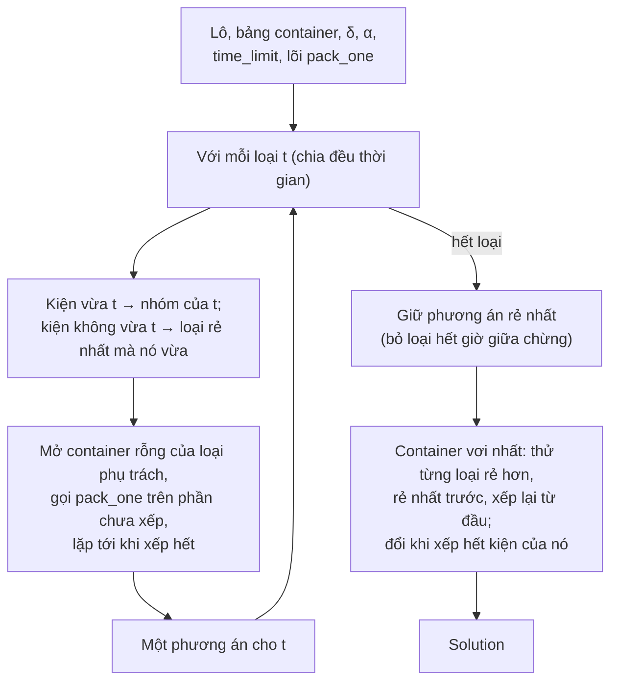

# Tầng chọn đội chung: từng loại, đổi container cuối

> Một phần của [đặc tả engine](README.md). Viết từ `src/engines/fleet.py`; code thắng khi lệch.

Tầng này biến một lõi xếp một container ([E1](core-e1.md), [E2](core-e2.md)) thành một phương án cả lô. E5 dùng nó cho **lời giải ban đầu** của mỗi lõi ([e5.md](e5.md)); baseline "lấp lần lượt một loại" của chế độ A cũng là nó, chạy với bảng chỉ một loại container ([README](README.md#3-so-sánh-baseline-và-cận-dưới)).

## 1. Thuật toán

Giao diện lõi: `pack_one(items, ctype, params, rng) -> placements` xếp được nhiều kiện nhất có thể vào **một container rỗng** loại `ctype`. Tầng chọn đội đánh số lại mọi container.

1. **Mỗi loại làm loại chính.** Với từng loại `t` trong bảng:
   - Kiện của dòng vừa `t` (kích thước lòng và cửa, ràng buộc 4, 9) thuộc nhóm `t`. Kiện của dòng không vừa `t` chuyển sang loại rẻ nhất mà nó vừa.
   - Mỗi nhóm: mở container rỗng của loại phụ trách, gọi `pack_one` trên mọi kiện chưa xếp, lặp tới khi xếp hết. Một lần gọi không xếp được kiện nào là lỗi của lõi (nếu không sẽ lặp mãi), báo ngay.
2. **Chọn phương án.** Giữ phương án rẻ nhất trong các loại chính.
3. **Đổi container cuối.** Container vơi nhất (theo tỉ lệ thể tích kiện ÷ thể tích lòng, không xét tải) được thử với từng loại rẻ hơn, rẻ nhất trước: gọi `pack_one` mới trên container rỗng loại đó với đúng các kiện của nó. Đổi sang loại đầu tiên xếp hết; không bao giờ đổi một phần, không chép lại tọa độ cũ (một lần xếp mới có thể tìm ra chỗ mà phép so kích thước thô bỏ sót).

## 2. Thời gian

Giới hạn chia đều cho các loại chính. Loại nào không xong trong phần của nó thì bị bỏ khỏi phép so, không trả phương án dở. Mọi loại hết giờ thì báo `FleetTimeout` (không có lời giải).

## 3. Khi dùng làm baseline

Chế độ A chạy tầng này với lõi E1 và bảng chỉ một loại container, mỗi loại một lần, 5 s, seed 1. Bước 1 khi đó không có loại nào khác để chuyển kiện không vừa, nên loại nào có dòng không vừa bị bỏ trước khi chạy (`src/plan/mode_a.py`); bước 3 không có loại rẻ hơn để đổi. Kết quả là đúng cách làm tay "lấp đầy từng container một loại cho tới hết hàng".
